<div align="center">

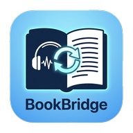

# BookBridge

**Switch between your audiobook and your ebook without losing your place.**

An open-source, self-hosted alternative to Amazon's Whispersync.

[](https://cporcellijr.github.io/bookbridge/)
[](LICENSE)
[](https://github.com/cporcellijr/bookbridge/releases)

[Documentation](https://cporcellijr.github.io/bookbridge/) · [Quick start](#quick-start) · [Screenshots](#screenshots) · [Releases](https://github.com/cporcellijr/bookbridge/releases)

</div>

<br>

<p align="center">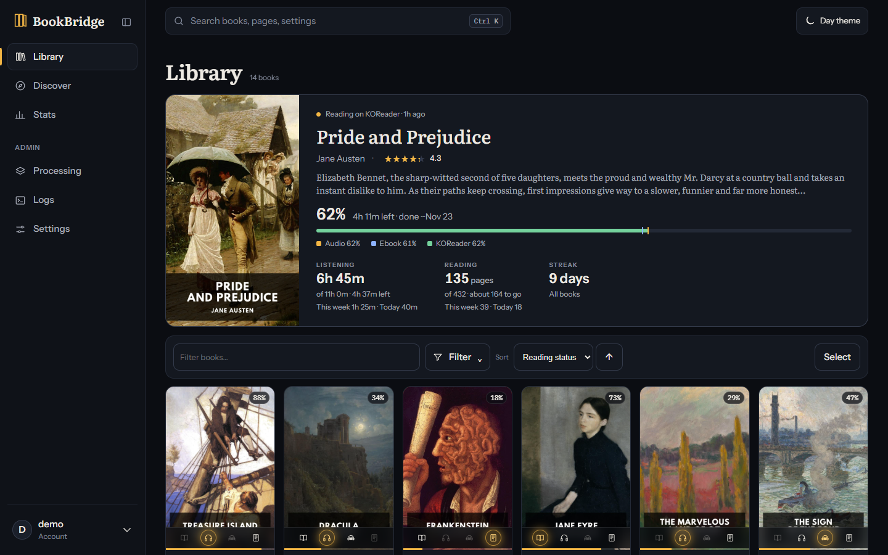</p>

Listen in Audiobookshelf on the drive home, then open the book in KOReader and it is already where you stopped. Read a few chapters before bed, and the audiobook picks up from there in the morning.

BookBridge lines up the audio with the text itself, so it works with the audiobook and EPUB files you already own. It runs on your own server in Docker: no Amazon account and no cloud service in between. Ebook-only setups work too, keeping two or more reading apps on the same page.

## What it does

<table>
<tr>
<td width="50%" valign="top">

**Keeps your place across formats**<br>
A minute in the audiobook becomes the matching page in the ebook, and back again. Go back on purpose in one app and the others follow, instead of pulling you forward.

</td>
<td width="50%" valign="top">

**Alignment built in**<br>
Forced alignment matches each audiobook against its ebook on the CPU and finds every chapter in the audio. Whisper transcription, EPUB timing data and Storyteller transcripts fill in when a book needs them.

</td>
</tr>
<tr>
<td valign="top">

**Works with the apps you already use**<br>
Audiobookshelf, KOReader, BookOrbit, Grimmory, Storyteller, Kavita, Calibre-Web Automated and BookFusion, with Hardcover and StoryGraph for tracking. Discover scans them for audiobook and ebook pairs you can link in bulk.

</td>
<td valign="top">

**A library worth opening**<br>
An optional card for the book you are reading now, with its synopsis, listening and reading stats and your streak. Browse as Cards, Face-out shelves, Spine shelves or List, in Day or Night, or keep the Classic interface.

</td>
</tr>
<tr>
<td valign="top">

**Highlights, notes and reading status**<br>
With the Bridge Sync KOReader plugin, highlights, notes, reading status and reading stats move between your devices and supported readers. The plugin can also deliver books to KOReader for you.

</td>
<td valign="top">

**One server for the whole household**<br>
Each reader signs in with their own service accounts and their own progress, and sees only the books they are reading, even when two people share a book.

</td>
</tr>
</table>

<details>
<summary><b>Everything it does</b></summary>

#### Sync

- Syncs progress across Audiobookshelf, KOReader, BookFusion, Storyteller, Grimmory, BookOrbit, Kavita, Calibre-Web Automated (Kobo sync) and reading trackers.
- Use Audiobookshelf, Grimmory or BookOrbit as the audio side; Audiobookshelf ebooks, BookFusion, Grimmory, BookOrbit, Kavita, Calibre-Web Automated or local files as the text side.
- Instant sync from Audiobookshelf playback and KOReader pushes, per-app polling, and a scheduled sweep as a safety net.
- Anti-regression guardrails, a deadband for tiny back-and-forth, and rewinds that stick once you continue from the new spot.
- Highlight and note relay to Grimmory, BookOrbit, BookFusion, Readest and Hardcover.

#### Alignment

- Forced alignment on the CPU in every image, with Whisper and EPUB SMIL timing as automatic fallbacks for books it can't follow (other languages, out-of-order narration, a different edition).
- Content-match protection catches wrong audiobook and ebook pairings.
- Alignment Health scores each map and lets you remap or restore earlier ones.
- Read-along EPUBs for BookOrbit, built from the book's own audio, ebook and alignment, with no Storyteller server needed.

#### Library and interface

- Optional currently-reading card: synopsis, listening and reading stats, streak.
- Cards, Face-out shelves, Spine shelves or List; cover size, shelf finish and what each card shows are yours to choose.
- Day and Night themes, a phone layout with bottom navigation, and the Classic interface for anyone who prefers it.
- Filter by author, series or format; sort by progress, status, last sync, date added, rating and more; group a series into one card.
- Book drawer showing where you are in every app, recent syncs and a "Show position" excerpt of the text.
- Listening and reading stats, with daily totals, a heatmap and a yearly recap, even without Audiobookshelf.
- English or Russian, chosen by each reader.

#### Matching and automation

- Discover finds audiobook and ebook pairs, including books in the same folder, and queues them in bulk; scheduled scans keep it current.
- Watched collections in Grimmory, BookOrbit and Kavita link anything you drop into them.
- A Job Queue shows waiting, running and finished work, and lets you reorder what is staged.
- Optional local-LLM assist (Ollama) for match suggestions and alignment rescue, off by default.

#### Setup and security

- Settings live in the web UI, with connection tests and one save for everything.
- Split-port mode exposes only the sync API to the internet and keeps the dashboard on your LAN.
- An optional admin API for provisioning readers and their integrations.
- Audiobookshelf can be switched off entirely for ebook-only setups.

</details>

## Screenshots

Shown with a demo library of public-domain classics.

#### The book you are reading now

<p align="center">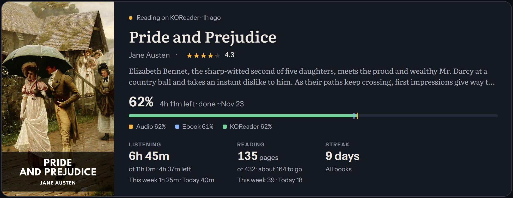</p>

<p align="center"><sub>Optional. Pick what it shows: synopsis, book stats, streak.</sub></p>

#### Browse your way

<table>
<tr>
<td width="50%">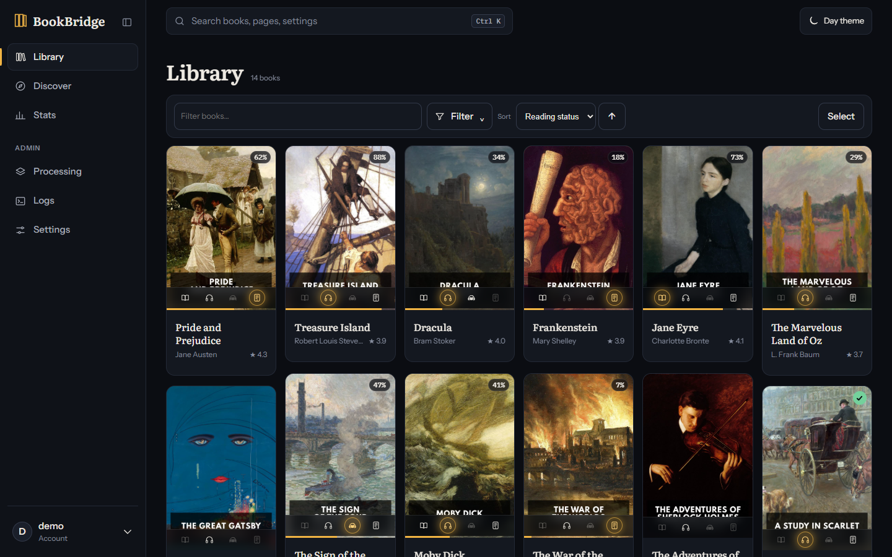<br><sub>Cards</sub></td>
<td width="50%">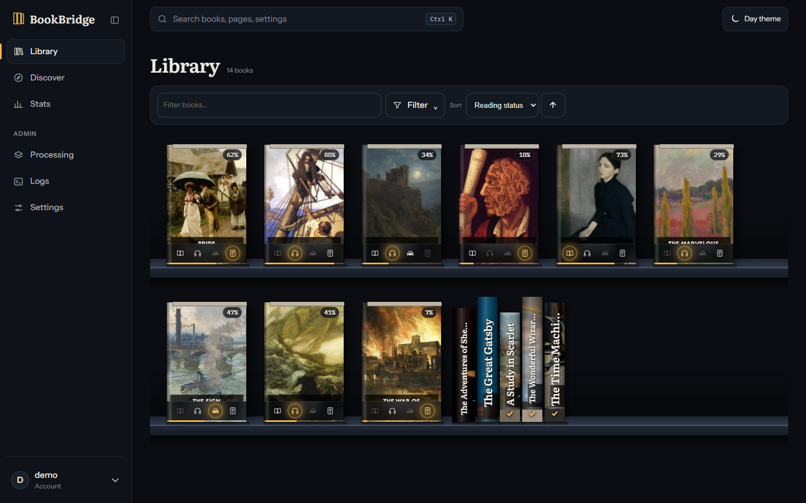<br><sub>Spine shelves</sub></td>
</tr>
<tr>
<td>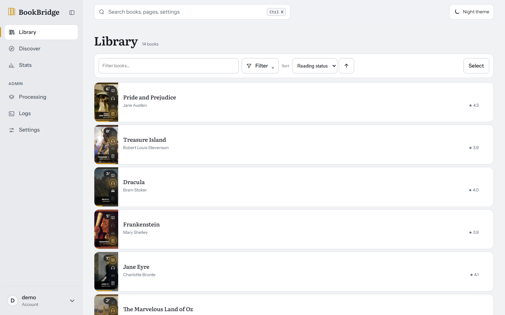<br><sub>List, in the Day theme</sub></td>
<td>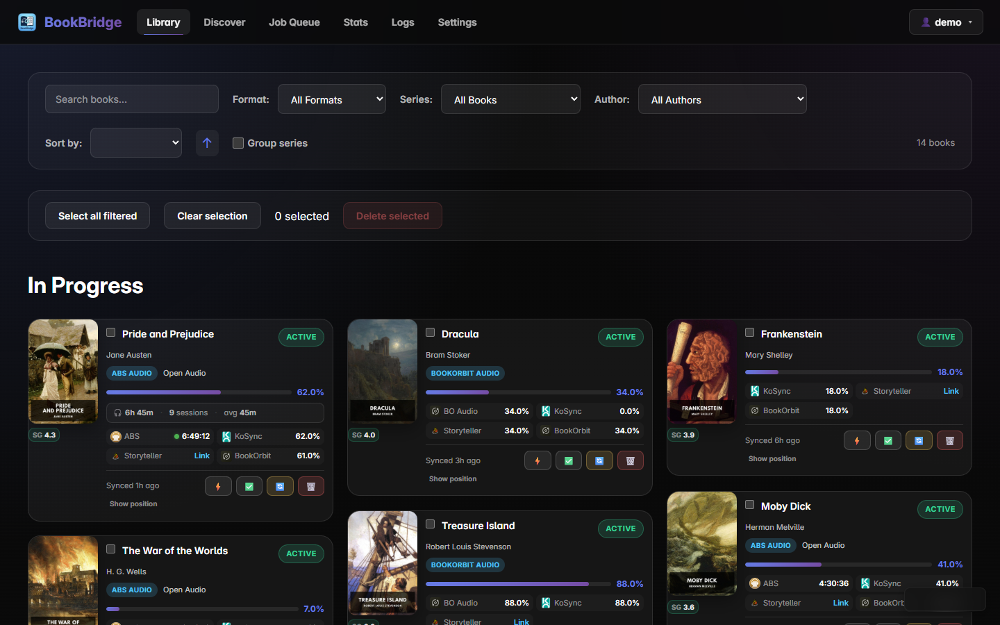<br><sub>Classic interface</sub></td>
</tr>
</table>

#### Every app in one place

<table>
<tr>
<td width="50%">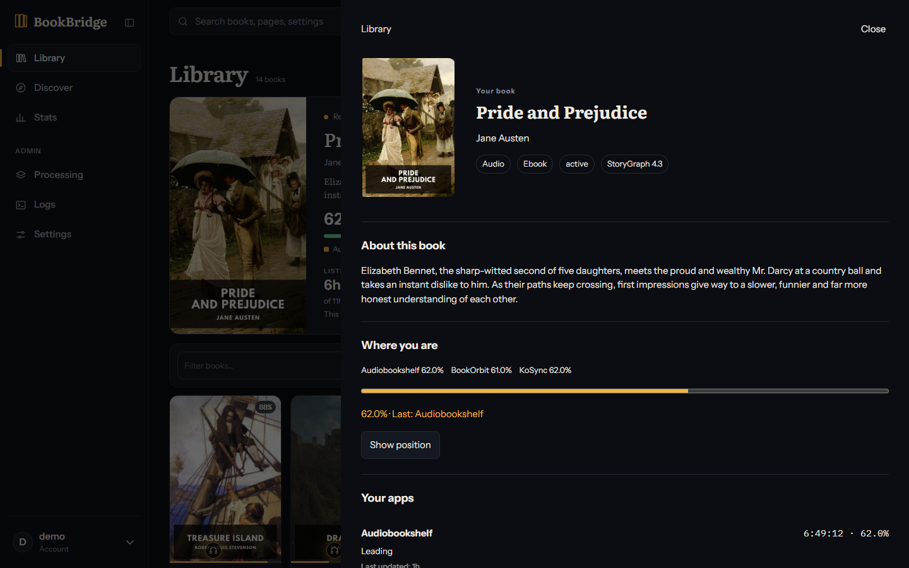<br><sub>Where you are in every app</sub></td>
<td width="50%">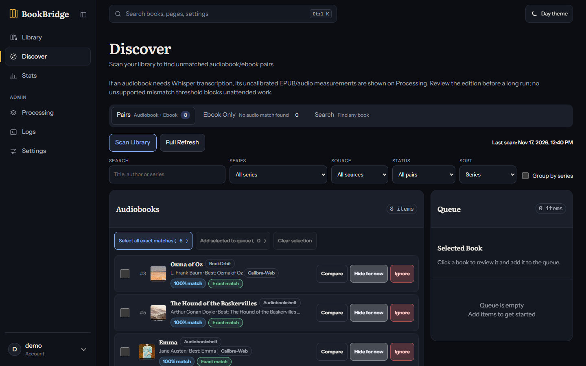<br><sub>Discover: audiobook and ebook pairs to link</sub></td>
</tr>
</table>

#### On your phone

<table>
<tr>
<td width="33%">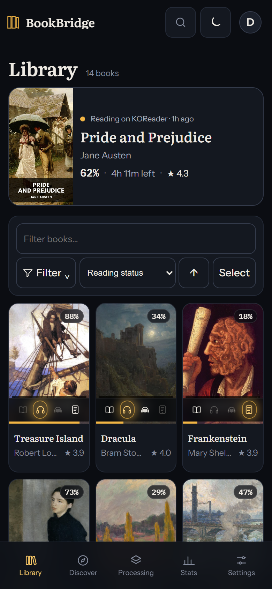</td>
<td width="33%">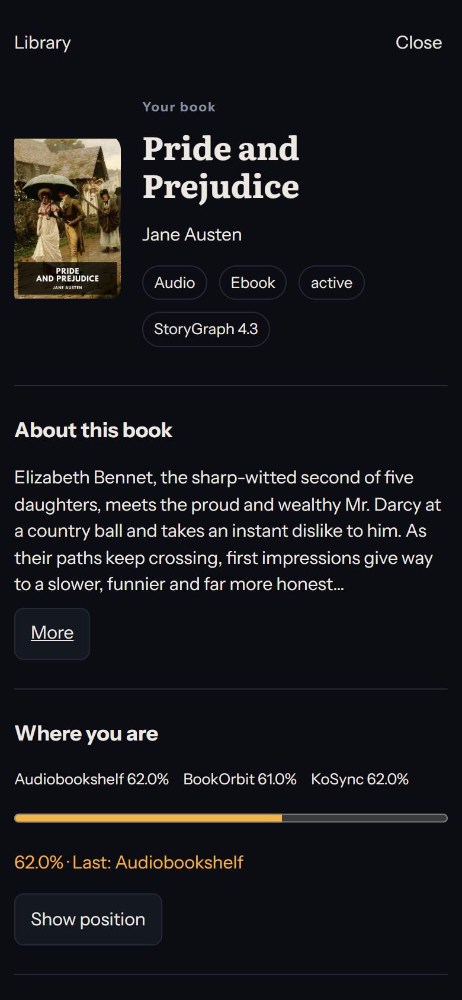</td>
<td width="33%">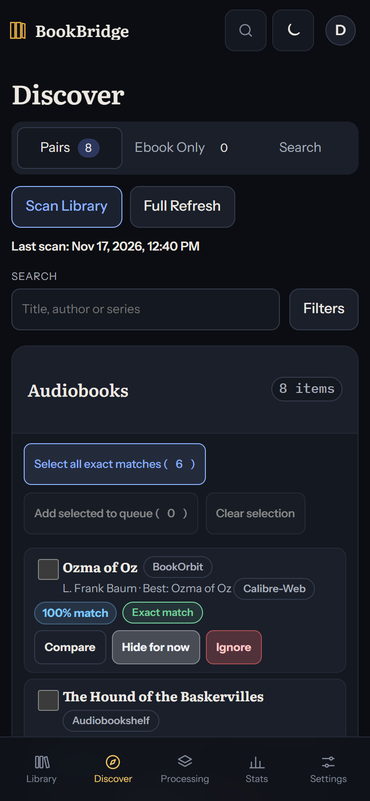</td>
</tr>
</table>

## Supported apps

| App | Use it for |
| :--- | :--- |
| **Audiobookshelf** | Audiobooks, plus its built-in ebook reader |
| **KOReader** | Ebooks on Kobo, PocketBook, Android or a jailbroken Kindle; highlights, notes and reading status with the Bridge Sync plugin |
| **Calibre-Web Automated** | Ebook source, and progress for stock Kobo readers through Kobo sync |
| **BookOrbit** | Audiobooks and ebooks, reading sessions, highlights, read-along EPUBs |
| **Grimmory** | Audiobooks and ebooks, reading sessions, highlights, shelves as KOReader collections |
| **Storyteller** | Read-along books, and better alignment for books you built there |
| **Kavita** | Ebooks, progress both ways, collection-based matching |
| **BookFusion** | Ebook progress, highlights, uploading your EPUBs |
| **Readest** | Highlight relay and uploading books into a group |
| **Hardcover, StoryGraph** | Reading trackers: progress, status, and Hardcover lists as KOReader collections |

Every app is optional. Turn on the ones you use and add more later.

## Quick start

```yaml
services:
  abs-kosync:
    container_name: abs_kosync
    image: ghcr.io/cporcellijr/bookbridge:latest
    restart: unless-stopped
    ports:
      - "8080:5757"
      # - "5758:5758"  # Optional: expose the sync-only port when using KOSYNC_PORT=5758
    environment:
      - TZ=America/New_York
      - LOG_LEVEL=INFO
      # - KOSYNC_PORT=5758  # Optional: enable split-port mode
      # Configure ABS, KOSync, Grimmory, BookOrbit, Kavita, CWA, Storyteller, and other services in the Web UI.
    volumes:
      - ./data:/data
      - /path/to/ebooks:/books
      # - /path/to/storyteller/assets:/storyteller/assets    # Optional: Storyteller transcript ingest
```

Run `docker compose up -d`, open `http://your-server:8080`, and connect your apps in **Settings**. The optional **Bridge Sync** KOReader plugin installs from the dashboard or from the [Releases](https://github.com/cporcellijr/bookbridge/releases) page.

## Documentation

- [Getting started](https://cporcellijr.github.io/bookbridge/getting-started/): install, first sync, volumes
- [User guide](https://cporcellijr.github.io/bookbridge/user-guide/): the dashboard, sync modes, highlights and notes
- [Configuration](https://cporcellijr.github.io/bookbridge/configuration/): every setting
- [Troubleshooting](https://cporcellijr.github.io/bookbridge/troubleshooting/): logs and common fixes

## Development

```bash
python -m pip install -e ".[dev]"
python tests/run_all_tests.py
```

The runner uses four workers and keeps each test file together; pass `-n 0` for a serial run. Checkouts and worktrees share one lock, so a second run waits for the first. On Windows, put `C:/Program Files/Git/bin` first on `PATH` for the backup-script tests. See [the performance measurements](docs/test-suite-performance.md) for details.

## Credits

BookBridge began as a fork of [abs-kosync-bridge](https://github.com/J-Lich/abs-kosync-bridge) by [@J-Lich](https://github.com/J-Lich), the original Audiobookshelf ↔ KOReader progress bridge this project grew out of. Thanks also to everyone who has contributed since; see the [contributors](https://github.com/cporcellijr/bookbridge/graphs/contributors).

## License

Released under the [MIT License](LICENSE).
