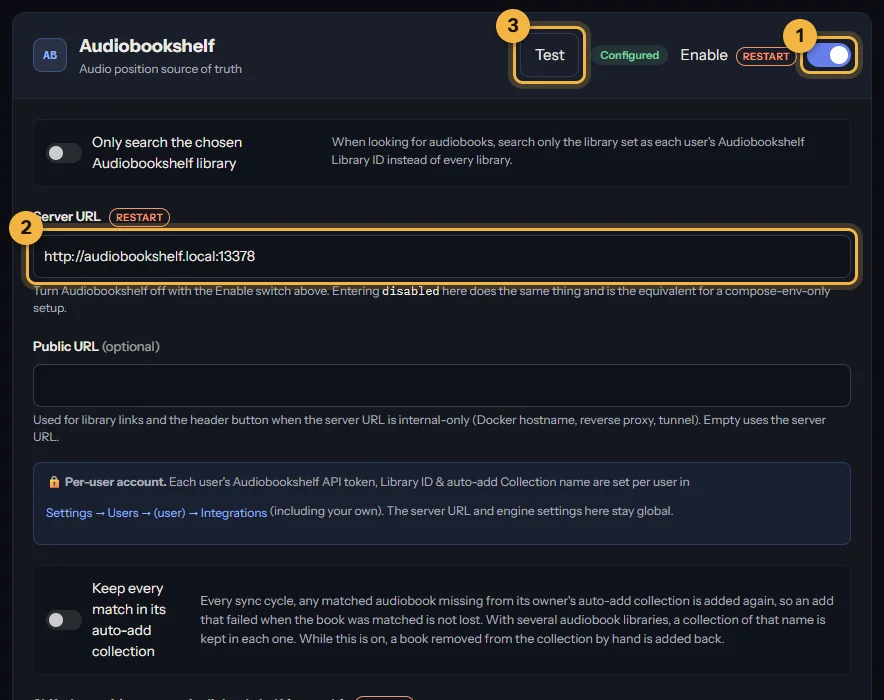
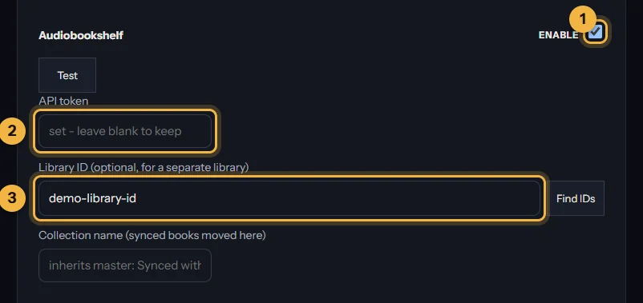

---
hide:
  - toc
description: "Connect Audiobookshelf to BookBridge: the server address in Settings, and each reader's API token in My Integrations."
---

# Audiobookshelf

BookBridge reads and writes your listening position in Audiobookshelf, and hears straight away when you move. Not using Audiobookshelf? Switch it off in step 1 and you are done.

## 1. Turn it on (admin)

**Settings → Services → Audiobookshelf**

{ .bb-shot loading=lazy }

1. **Enable.** Switching it off turns Audiobookshelf off for everyone on the server.
2. **Server URL:** the address the BookBridge server reaches Audiobookshelf at.
3. **Test** checks the connection, then **Save Settings**.

## 2. Add your login (each reader)

**Account → My Integrations → Audiobookshelf**

{ .bb-shot loading=lazy }

1. **Enable** it for your account.
2. **API token:** in Audiobookshelf, open **Settings → API Keys** and create one.
3. **Library ID** (optional) keeps your matches to one Audiobookshelf library. **Find IDs** lists them.

Then **Save integrations**.

??? info "Other options"
    - **Collection name** (My Integrations): matched audiobooks are added to this Audiobookshelf collection.
      **Keep every match in its auto-add collection** (Settings) adds back any that went missing.
    - **Only search the chosen Audiobookshelf library:** searches only each reader's Library ID instead of every library.
    - **Public URL:** the address used for links when the Server URL only works inside Docker.
    - **Shift the position sent to Audiobookshelf:** rewinds the position BookBridge writes by this many seconds.
    - **Sync with Audiobookshelf's own ebook reader** treats the ebook attached to an Audiobookshelf item as one more
      reader. Leave **ABS Ebook Position Format** on CFI, which the official apps use, unless a reader keeps opening
      books at the wrong place.
    - **Save my ebook reading as entries in my Audiobookshelf listening history** is under
      My Integrations → Reading preferences.
