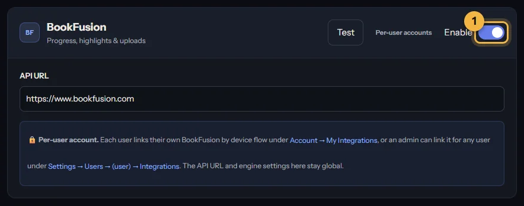
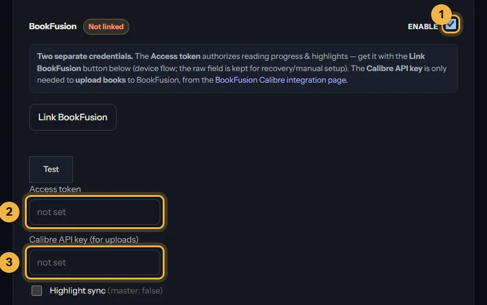

---
hide:
  - toc
description: "Connect BookFusion to BookBridge: link each reader's BookFusion account from My Integrations."
---

# BookFusion

BookBridge syncs your reading position and highlights with BookFusion, and can upload a local EPUB to your BookFusion bookshelf.

## 1. Turn it on (admin)

**Settings → Services → BookFusion**

{ .bb-shot loading=lazy }

1. **Enable**, then **Save Settings**. Leave the API URL as it is.

## 2. Link your account (each reader)

**Account → My Integrations → BookFusion**

{ .bb-shot loading=lazy }

1. **Enable** it for your account.
2. **Access token:** choose **Link BookFusion** above it and follow the steps; that fills this in for you.
3. **Calibre API key**, only needed to upload books. Get it from the [BookFusion Calibre integration page](https://www.bookfusion.com/integrations/calibre).

Turn on **Highlight sync** to relay highlights too, then **Save integrations**.

When a book has no BookFusion match, the link flow offers **Upload to BookFusion** if the book has a local EPUB and you have a Calibre API key.
