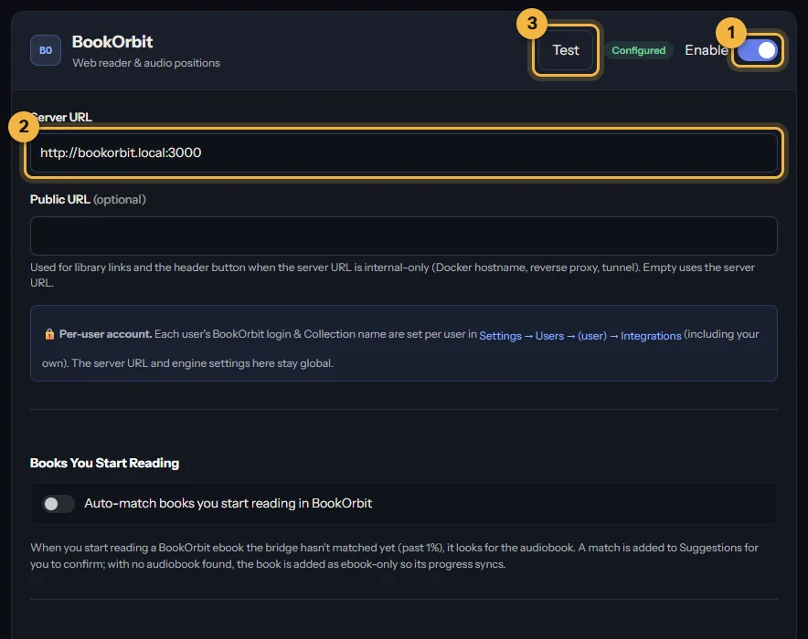
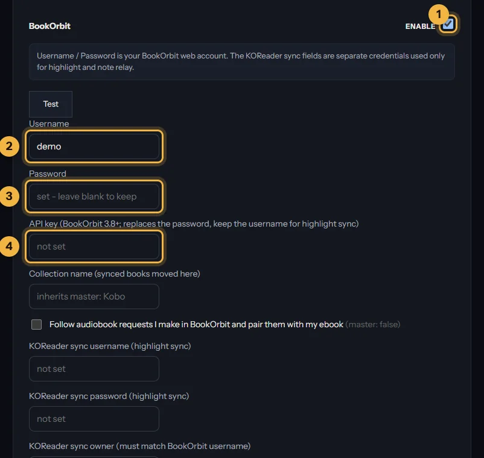

---
hide:
  - toc
description: "Connect BookOrbit to BookBridge: the server address in Settings, and each reader's login or API key in My Integrations."
---

# BookOrbit

BookOrbit can hold both the audiobook and the ebook. BookBridge syncs your listening and reading position, records reading sessions, and can relay highlights from BookOrbit's web reader.

## 1. Turn it on (admin)

**Settings → Services → BookOrbit**

{ .bb-shot loading=lazy }

1. **Enable.**
2. **Server URL:** the address the BookBridge server reaches BookOrbit at.
3. **Test** checks the connection, then **Save Settings**.

## 2. Add your login (each reader)

**Account → My Integrations → BookOrbit**

{ .bb-shot loading=lazy }

1. **Enable** it for your account.
2. **Username** of your BookOrbit web account.
3. **Password** of that account.
4. **API key** instead of the password, on BookOrbit 3.8 and newer. It also works when BookOrbit only allows single sign-on. Create it in BookOrbit under **Settings → API keys** with **Write** access and the Download, Upload, Delete books and Manage libraries permissions.

Then **Save integrations**.

**Highlights from BookOrbit's web reader** need the **KOReader sync username** and **password** further down: the separate KOReader sync login from BookOrbit's own settings, not your web account.

??? info "Other options"
    - **Collection name** (My Integrations): matched books are moved to this BookOrbit collection.
    - **Follow audiobook requests I make in BookOrbit and pair them with my ebook** (My Integrations).
    - **Auto-match books you start reading in BookOrbit** (Settings): once you pass 1% of an unmatched ebook,
      BookBridge looks for its audiobook and suggests the match.
    - **When BookOrbit syncs read-along books itself** (Settings): only matters when one BookOrbit entry holds both
      the audio and the text. **Let BookOrbit handle it** is the default.
    - **Read-Along Audio Bitrate** (Settings): the audio quality of
      [read-along EPUBs](../user-guide.md#read-along-epubs-for-bookorbit).
    - A watched **"Up Next" shelf** that matches whatever you put on it is under
      **Settings → Library & Matching**.
