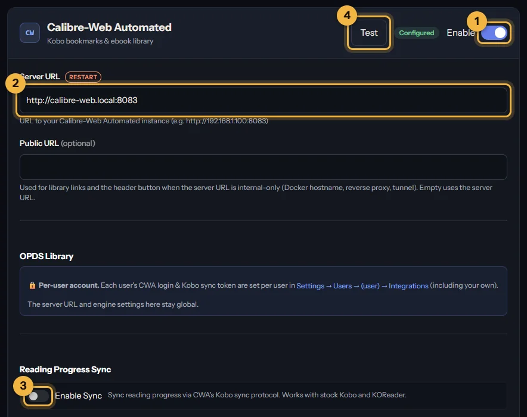
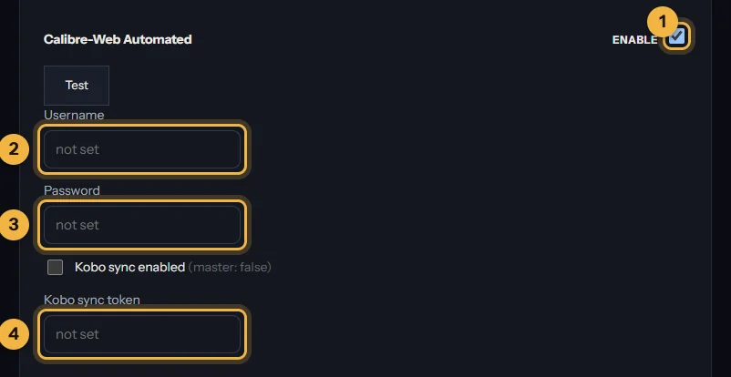

---
hide:
  - toc
description: "Connect Calibre-Web Automated to BookBridge for ebooks to link and Kobo reading position through CWA's Kobo sync."
---

# Calibre-Web Automated

BookBridge can find and download ebooks from Calibre-Web Automated (CWA). With Kobo sync on, it also syncs the position of a Kobo, or KOReader, that syncs through CWA.

## 1. Turn it on (admin)

**Settings → Services → Calibre-Web Automated**

{ .bb-shot loading=lazy }

1. **Enable.**
2. **Server URL:** the address the BookBridge server reaches CWA at.
3. **Enable Sync** under Reading Progress Sync, if you want Kobo position sync.
4. **Save Settings**, then add and save your login in step 2. **Test** checks the connection once that login is saved.

## 2. Add your login (each reader)

**Account → My Integrations → Calibre-Web Automated**

{ .bb-shot loading=lazy }

1. **Enable** it for your account.
2. **Username** of your CWA account.
3. **Password** of that account.
4. **Kobo sync token:** in CWA, edit your user and open **OAuth & API Integrations → Kobo Sync Token → Create/View**. Enter only the part after `/kobo/` in the address it shows, not the whole URL. Tick **Kobo sync enabled** as well.

Then **Save integrations**.

??? info "Other options"
    - **Write Kobo span bookmarks** (Settings, on by default) sends a position the Kobo can jump to. Turn it off to
      send a percentage only.
    - **Calibre Library Path** (Settings): point it at the Calibre library, mounted read-only, so BookBridge
      recognises a KOReader copy that CWA rewrote when it was downloaded.
    - **Trust the Audiobookshelf ID stored in Calibre** (Settings) uses that ID to match books without guessing.
