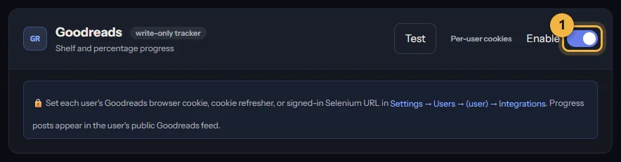
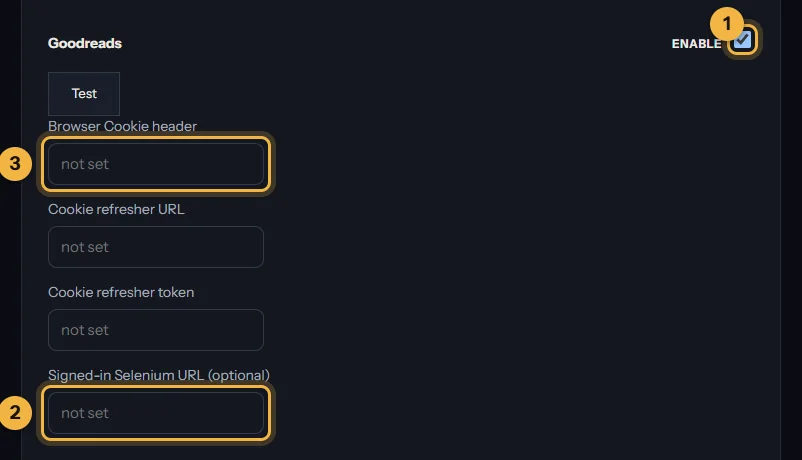

---
hide:
  - toc
description: "Connect Goodreads to BookBridge through a signed-in browser or a session cookie."
---

# Goodreads

Goodreads is a tracker: BookBridge posts your progress, page count and finished books to it. It never moves your place in other apps.

!!! warning "Unofficial"
    Goodreads has no public API, so BookBridge works through your own signed-in session, and updates appear in your feed like ones you post yourself. Goodreads' terms don't allow automated access and its pages can change, so updates may stop until BookBridge is updated.

## 1. Turn it on (admin)

**Settings → Services → Goodreads**

{ .bb-shot loading=lazy }

<div class="bb-callouts" markdown>
1. **Enable**, then **Save Settings**.
</div>

## 2. Connect your account (each reader)

**Account → My Integrations → Goodreads**

{ .bb-shot loading=lazy }

<div class="bb-callouts" markdown>
1. **Enable** it for your account.
2. **Signed-in Selenium URL** (recommended): the address of a Chrome that is signed in to Goodreads, for example `http://selenium:4444`.
3. **Browser Cookie header**: without a browser, paste your Goodreads `Cookie` header instead. It is the least reliable option.
</div>

Then **Save integrations**.

??? info "Setting up the signed-in browser"
    Goodreads often blocks plain requests as a bot, so a real browser works best. BookBridge does not open the
    browser itself: it uses the one Chrome session that is already open on goodreads.com. The
    [goodreads-cookie-refresher](https://github.com/Lyfts/goodreads-cookie-refresher) service opens that session
    and keeps it alive, so run the two containers together, on the same Docker network as BookBridge:

    ```yaml
    services:
      selenium:
        image: selenium/standalone-chrome:latest
        shm_size: 2gb
        ports:
          - "192.168.1.10:7900:7900"  # noVNC, on your server's LAN address only
        environment:
          SE_VNC_PASSWORD: "choose-a-password"
          SE_NODE_SESSION_TIMEOUT: "86400"  # Selenium ends an idle session after 300 seconds by default
        volumes:
          - chrome-profile:/home/seluser/Downloads
        # The profile outlives the container, but Chrome's lock files name the old container,
        # so after an image update Chrome refuses the profile. Clear them, then start as usual.
        entrypoint: ["/bin/bash", "-c"]
        command:
          - |
            find /home/seluser/Downloads -mindepth 2 -maxdepth 2 \( -name SingletonLock -o -name SingletonSocket -o -name SingletonCookie -o -name DevToolsActivePort \) -delete
            exec /opt/bin/entry_point.sh
      refresher:
        image: ghcr.io/lyfts/goodreads-cookie-refresher:latest
        depends_on:
          - selenium
        environment:
          SELENIUM_URL: http://selenium:4444
          TARGET_URL: https://www.goodreads.com/
          PROFILE_DIR: /home/seluser/Downloads/profile
          REFRESH_INTERVAL_SECONDS: "1200"
    volumes:
      chrome-profile:
    ```

    1. Start both. The refresher opens Chrome on Goodreads and revisits it every 20 minutes, which keeps the
       session open.
    2. Open the noVNC view at `http://your-server:7900`, enter the VNC password, and sign in to Goodreads in
       that Chrome window. Leave it open.
    3. Under **My Integrations → Goodreads**, set **Signed-in Selenium URL** to `http://selenium:4444`.

    Keep port 4444 off your host's ports: that browser is signed in as you. Each Goodreads account needs its
    own pair of containers. The refresher can also hand BookBridge a fresh cookie when Goodreads rejects one:
    enter `http://refresher:8080` as **Cookie refresher URL**, and its `AUTH_TOKEN` as **Cookie refresher
    token** if you set one.
