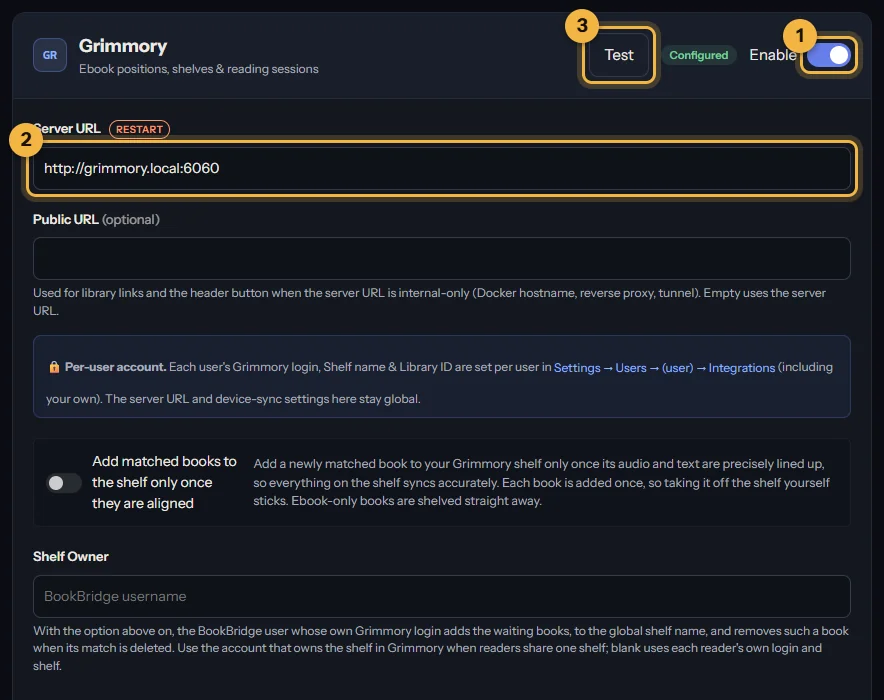
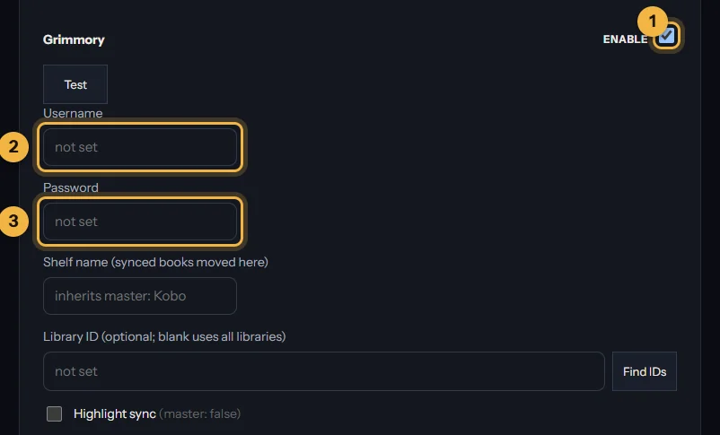

---
hide:
  - toc
description: "Connect Grimmory to BookBridge: the server address in Settings, and each reader's login in My Integrations."
---

# Grimmory

Grimmory can hold both the audiobook and the ebook. BookBridge syncs your listening and reading position, records reading sessions, relays highlights from Grimmory's web reader, and can turn your shelves into KOReader collections.

## 1. Turn it on (admin)

**Settings → Services → Grimmory**

{ .bb-shot loading=lazy }

1. **Enable.**
2. **Server URL:** the address the BookBridge server reaches Grimmory at.
3. **Save Settings**, then add and save your login in step 2. **Test** checks the connection once that login is saved.

## 2. Add your login (each reader)

**Account → My Integrations → Grimmory**

{ .bb-shot loading=lazy }

1. **Enable** it for your account.
2. **Username** of your Grimmory account.
3. **Password**, then **Save integrations**.

??? info "Other options"
    - **Shelf name** (My Integrations): matched books go on this Grimmory shelf. **Library ID** keeps matches to one
      library.
    - **Highlight sync** (My Integrations) relays highlights and notes from Grimmory's web reader.
    - **Add matched books to the shelf only once they are aligned** (Settings) holds a new audiobook and ebook pair
      back until its alignment is done. **Shelf Owner** is for a shelf that one Grimmory account owns.
    - **KOReader Collections** (My Integrations) turns your shelves into collections on your devices; see
      [KOReader](koreader.md#koreader-collections-optional).
    - **Settings → Maintenance → Refresh Grimmory Cache** after a big import or clean-up.
