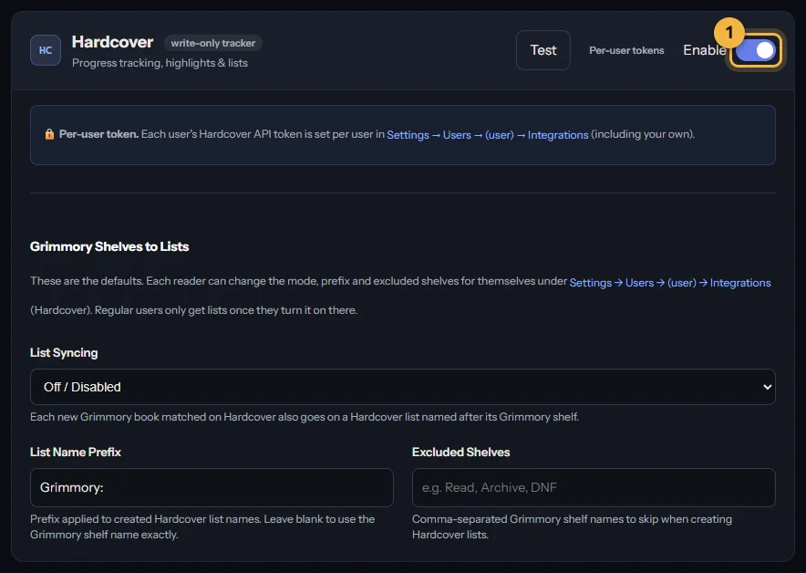
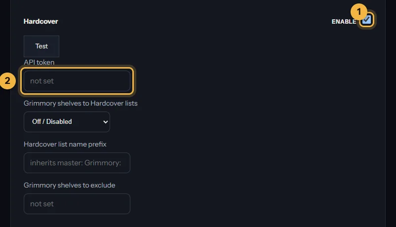

---
hide:
  - toc
description: "Connect Hardcover to BookBridge: turn it on in Settings, and each reader adds their Hardcover API token in My Integrations."
---

# Hardcover

Hardcover is a tracker: BookBridge posts your progress and finished books to it, and can push highlights and turn Grimmory shelves into Hardcover lists. It never moves your place in other apps.

## 1. Turn it on (admin)

**Settings → Services → Hardcover**

{ .bb-shot loading=lazy }

1. **Enable**, then **Save Settings**.

How soon progress is posted is under **Settings → Reading & Sync → Posting to trackers**.

## 2. Add your token (each reader)

**Account → My Integrations → Hardcover**

{ .bb-shot loading=lazy }

1. **Enable** it for your account.
2. **API token:** copy your personal API token from your Hardcover account settings.

Then **Save integrations**.

??? info "Other options"
    - Pick the edition you are reading from the book's page in BookBridge, so page counts are right.
    - **Grimmory shelves to Hardcover lists** (My Integrations, with defaults on the Settings card) adds each matched
      Grimmory book to a Hardcover list named after its shelf.
    - Hardcover lists can also become KOReader collections; see [KOReader](koreader.md#koreader-collections-optional).
    - **Also post my highlights to Hardcover** (Settings → Reading & Sync → Highlights & notes) posts KOReader
      highlights made in the yellow style.
