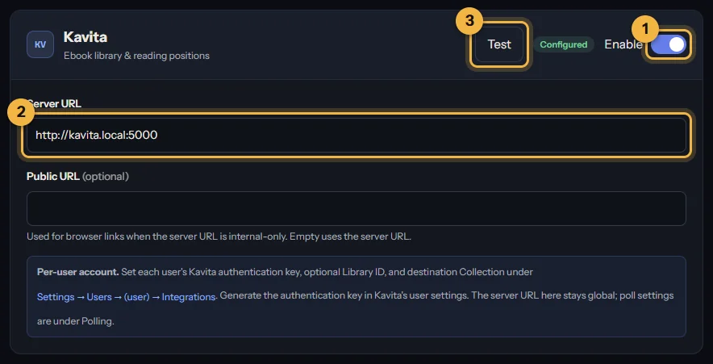
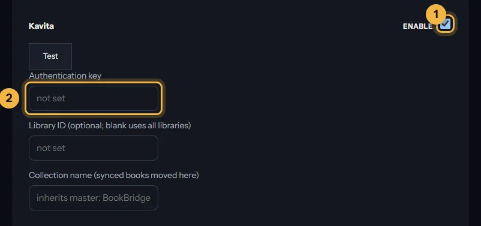

---
hide:
  - toc
description: "Connect Kavita to BookBridge: the server address in Settings, and each reader's Kavita authentication key in My Integrations."
---

# Kavita

BookBridge syncs your reading position with Kavita both ways and can link its EPUBs. It uses Kavita's KOReader progress support, so Kavita's own web reader sees the same place.

## 1. Turn it on (admin)

**Settings → Services → Kavita**

{ .bb-shot loading=lazy }

1. **Enable.**
2. **Server URL:** the address the BookBridge server reaches Kavita at.
3. **Save Settings**, then add and save your login in step 2. **Test** checks the connection once that login is saved.

## 2. Add your key (each reader)

**Account → My Integrations → Kavita**

{ .bb-shot loading=lazy }

1. **Enable** it for your account.
2. **Authentication key:** in Kavita, open **User Settings → 3rd Party Clients** and create a key that does not expire. Treat it like a password.

Then **Save integrations**.

??? info "Other options"
    - **Library ID** (My Integrations) keeps matches to one Kavita library; blank uses every EPUB library the key
      can see.
    - **Collection name** (My Integrations): matched books are moved to this Kavita collection. The Kavita user needs
      permission to manage collections for this.
    - **Public URL** (Settings): the address used for links when the Server URL only works inside Docker.
    - A watched **"Up Next" collection** that matches whatever you add to it is under
      **Settings → Library & Matching**.
    - EPUB only: comics and PDFs are not synced.
