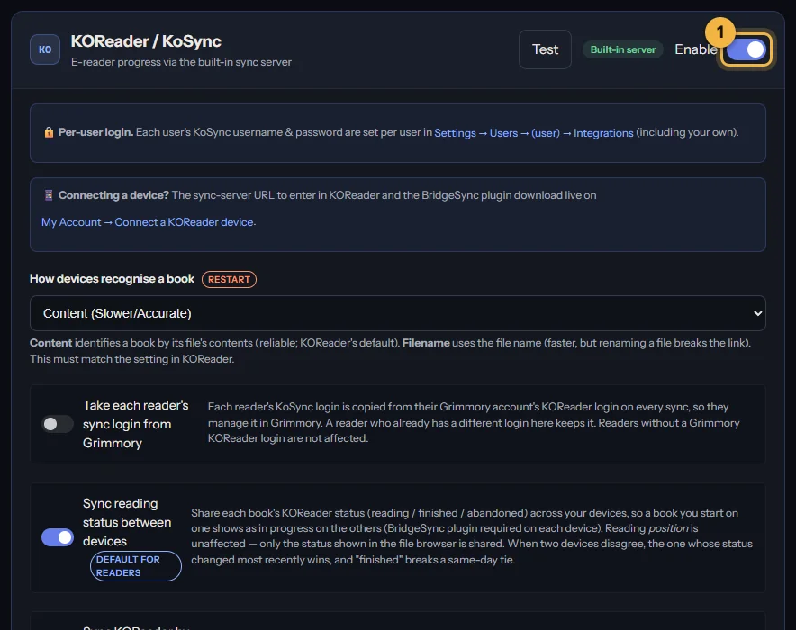
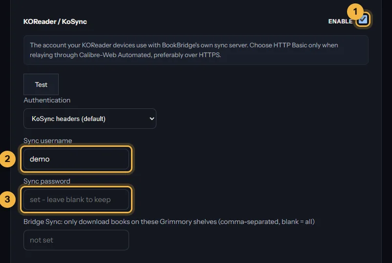
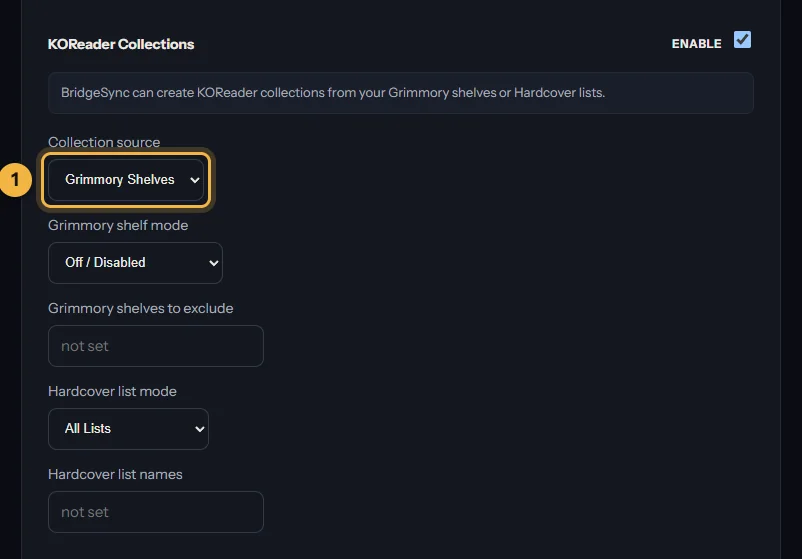

---
hide:
  - toc
description: "Connect KOReader to BookBridge's built-in sync server, choose a sync login, and set up KOReader collections."
---

# KOReader

BookBridge is a KOReader sync server, so devices sync straight to it with no other server. Position sync works with plain KOReader. The free Bridge Sync plugin adds highlights, notes, reading status, History and book delivery.

## 1. Turn it on (admin)

**Settings → Services → KOReader / KoSync**

{ .bb-shot loading=lazy }

1. **Enable**, then **Save Settings**.

Leave **How devices recognise a book** on Content. It must match the same setting in KOReader.

## 2. Choose your sync login (each reader)

**Account → My Integrations → KOReader / KoSync**

{ .bb-shot loading=lazy }

1. **Enable** it for your account.
2. **Sync username:** any name you like. It is your login for BookBridge's sync server, not an account anywhere else.
3. **Sync password**, then **Save integrations**.

Leave **Authentication** on KoSync headers. HTTP Basic is only for relaying through Calibre-Web Automated.

## 3. Connect the device

Open **Account → Connect a KOReader device** and follow [Connect a KOReader device](../getting-started.md#6-connect-a-koreader-device-optional). In KOReader, use **Login** with the username and password from step 2. **Register** only works for a login already saved in My Integrations.

## KOReader collections (optional)

**Account → My Integrations → KOReader Collections**

{ .bb-shot loading=lazy }

1. **Collection source:** turn your Grimmory shelves or your Hardcover lists into KOReader collections. Needs the Bridge Sync plugin.

??? info "Other options"
    - **Reading preferences** (My Integrations) has your own switches for copying highlights between devices,
      showing a book as reading or finished everywhere, sharing History, and stopping an out-of-date device moving
      you backwards.
    - **Bridge Sync: only download books on these Grimmory shelves** limits which books the plugin puts on the device.
    - **Take each reader's sync login from Grimmory** (Settings) copies each reader's KOReader login from their
      Grimmory account.
    - **Sync KOReader by percentage instead of exact position** (Settings) skips the text matching.
    - **Advanced — behind a reverse proxy:** list your proxy under **Trusted proxy addresses**. Five wrong
      passwords lock a sign-in out for a minute, and this makes the lockout follow each device's own address
      instead of everyone sharing the proxy's.
    - **Advanced — cross-device progress:** **When two KOReader devices disagree** starts on watch-and-log only.
    - **Advanced — external KoSync server:** leave **Target KOSync URL** empty to use the built-in server.
