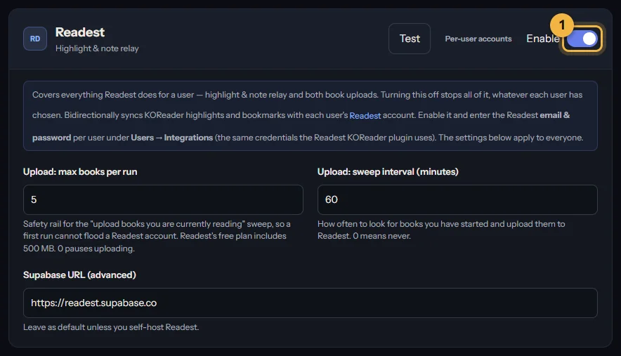
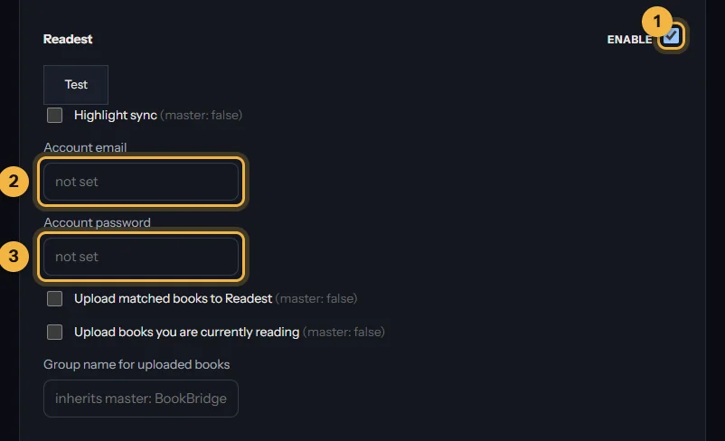

---
hide:
  - toc
description: "Connect Readest to BookBridge for highlight and note sync and book uploads. Readest is not a reading-position source."
---

# Readest

BookBridge relays highlights and notes through Readest's cloud sync, and can upload copies of your books to Readest. It does not sync your reading position with Readest.

## 1. Turn it on (admin)

**Settings → Services → Readest**

{ .bb-shot loading=lazy }

1. **Enable** is on by default. Switching it off stops everything Readest does, for everyone.

**Upload: max books per run** caps each upload sweep so a first run cannot fill an account; 0 pauses uploads.

## 2. Add your login (each reader)

**Account → My Integrations → Readest**

{ .bb-shot loading=lazy }

1. **Enable** it for your account.
2. **Account email** of your Readest account.
3. **Account password**.

Then choose what you want: **Highlight sync**, **Upload matched books to Readest** and **Upload books you are currently reading**. Both upload switches are off until you turn them on. **Save integrations**.

??? info "About uploads"
    - Only EPUBs are uploaded, into the **Group name** you choose.
    - The currently-reading sweep only uploads books you have started and not finished, and skips any already in
      your Readest account, which matters on Readest's 500 MB free plan.
    - Uploading never changes your Readest position, status or cover. If the account runs out of storage,
      BookBridge logs it and stops uploading.
