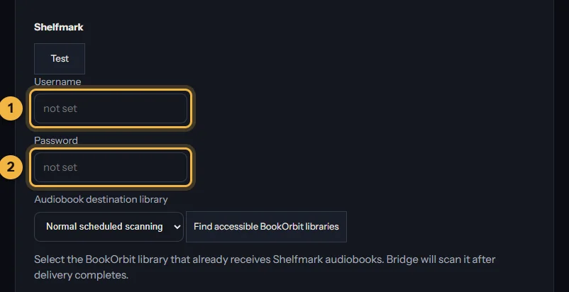

---
hide:
  - toc
description: "Connect Shelfmark to BookBridge so readers can request a missing audiobook or ebook."
---

# Shelfmark

When a Discover search finds only the audiobook or only the ebook, readers can ask Shelfmark for the missing half, and BookBridge pairs it when it arrives. See [Getting missing books](../using/get-books.md).

## 1. Turn it on (admin)

Under **Settings → Library & Matching → Shelfmark**, turn on **Enable Shelfmark** and enter the **Shelfmark URL**, then **Save Settings**.

Admins can always request books. To let other readers request them too, turn on **Let readers get missing books** under **Getting books** on the same tab.

## 2. Add your login (each reader)

**Account → My Integrations → Shelfmark**

{ .bb-shot loading=lazy }

1. **Username** of your Shelfmark account.
2. **Password**, then **Save integrations**.

**Audiobook destination library** (optional) is the BookOrbit library to scan when a Shelfmark audiobook download finishes. Leave it blank to wait for BookOrbit's normal scans.
