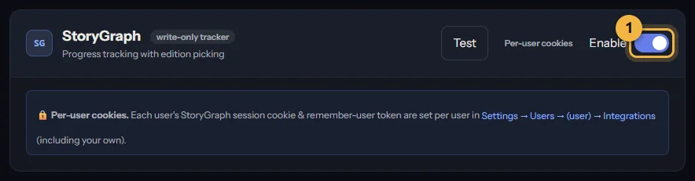
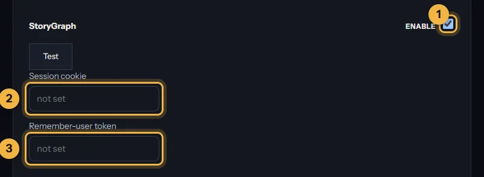

---
hide:
  - toc
description: "Connect StoryGraph to BookBridge with two cookies from a signed-in browser."
---

# StoryGraph

StoryGraph is a tracker: BookBridge posts your progress and finished books to it. It never moves your place in other apps. StoryGraph has no API, so BookBridge signs in with two cookies from your browser.

## 1. Turn it on (admin)

**Settings → Services → StoryGraph**

{ .bb-shot loading=lazy }

1. **Enable**, then **Save Settings**.

## 2. Add your cookies (each reader)

**Account → My Integrations → StoryGraph**

{ .bb-shot loading=lazy }

1. **Enable** it for your account.
2. **Session cookie:** the value of the `_storygraph_session` cookie.
3. **Remember-user token:** the value of the `remember_user_token` cookie.

Then **Save integrations**. [How to copy the cookies](../user-guide.md#storygraph-authentication) from your browser.

Signing out of StoryGraph in that browser can end the session. If updates stop, copy the cookies again.

When the edition you pick has a page count, BookBridge reports progress in pages.
