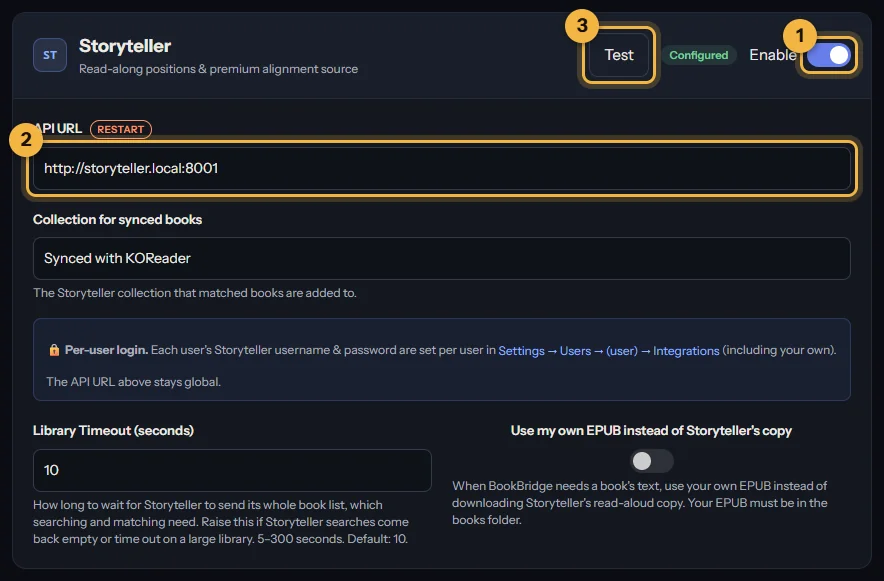
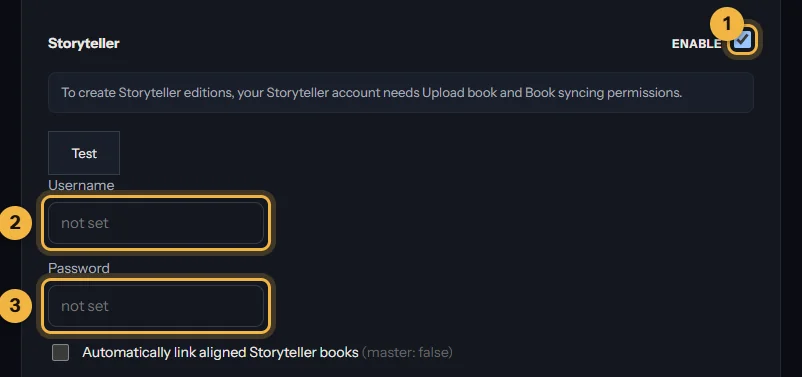

---
hide:
  - toc
description: "Connect Storyteller to BookBridge: the API address in Settings, and each reader's login in My Integrations."
---

# Storyteller

Storyteller is optional: BookBridge lines up audiobooks and ebooks on its own. Connect it if you use the Storyteller read-along app. BookBridge then syncs its position too and uses its transcripts when lining books up.

## 1. Turn it on (admin)

**Settings → Services → Storyteller**

{ .bb-shot loading=lazy }

1. **Enable.**
2. **API URL:** the address the BookBridge server reaches Storyteller at.
3. **Test** checks the connection, then **Save Settings**.

## 2. Add your login (each reader)

**Account → My Integrations → Storyteller**

{ .bb-shot loading=lazy }

1. **Enable** it for your account.
2. **Username** of your Storyteller account.
3. **Password**, then **Save integrations**.

To create Storyteller editions, your Storyteller account needs the Upload book and Book syncing permissions.

??? info "Other options"
    - **Automatically link aligned Storyteller books** (My Integrations): once an hour, links books Storyteller has
      finished aligning to your matching BookBridge books.
    - **Collection for synced books** (Settings): linked books are added to this Storyteller collection.
    - **Use my own EPUB instead of Storyteller's copy** (Settings): when BookBridge needs a book's text, it reads
      your EPUB from the books folder instead of downloading Storyteller's read-aloud copy.
    - **Library Timeout** (Settings): raise it for a large library or a slow server.
    - **Storyteller Assets Path** (Settings → Server → System Paths) lets BookBridge read Storyteller's transcripts
      from disk; see the optional extras in [Getting Started](../getting-started.md#2-start-bookbridge).
