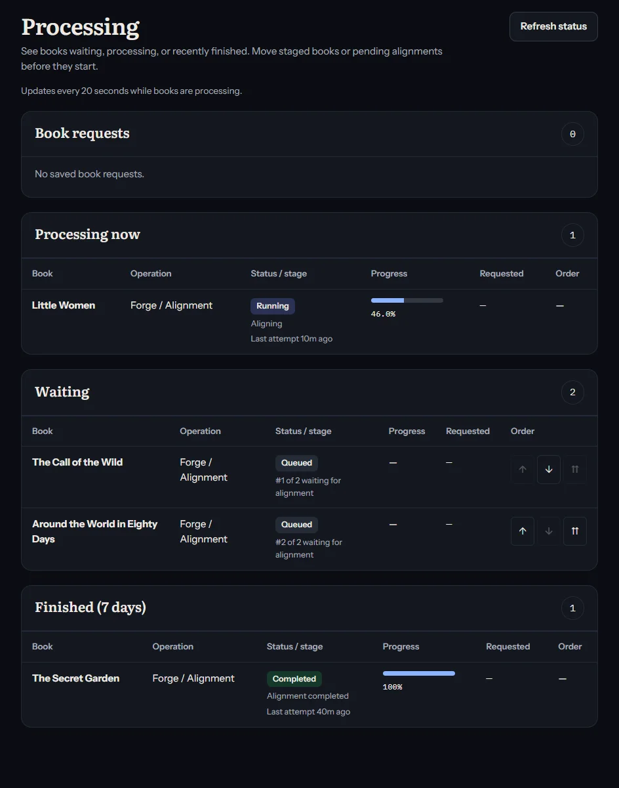

---
hide:
  - toc
description: "Follow a book from the moment you pair it to the moment every app is in step, including a missing half fetched for you."
---

# From new book to in sync

What happens between choosing a book and picking up your audiobook at the page you stopped reading.

:material-bookshelf:{ .bb-flow__icon }

**Pick a pair**

An audiobook and the ebook that goes with it.

:material-timer-sand:{ .bb-flow__icon }

**Wait your turn**

Books line up, one at a time, in the order you choose.

:material-waveform:{ .bb-flow__icon }

**Line them up**

Every minute of audio is matched to its place in the text.

:material-book-sync:{ .bb-flow__icon }

**In sync**

Every app picks up where you left off.

:material-tray-arrow-down:{ .bb-flow__icon } **Missing half?** BookBridge fetches it from BookOrbit or Shelfmark, and it joins the line when it arrives.

## Pick a pair

Discover suggests audiobooks and ebooks that look like the same book. Add the ones you want to the queue, then press **Match All**. You can also search for any book yourself.

{ .bb-shot loading=lazy }

## Missing a half?

Have the ebook but not the audiobook, or the other way round? Ask for it from Discover. BookBridge requests it from BookOrbit or Shelfmark, waits for it to land in your library, makes sure it is the right book and edition, and pairs it with your copy. From there it joins the line like any other book.

{ .bb-shot loading=lazy width="440" }

## Wait your turn

**Processing** shows every book in line. BookBridge works on one book at a time so your server never gets swamped. Change the order whenever you like: move a waiting book up, down or straight to the front, and the one you want most is done next. A book with only an ebook or only an audiobook has nothing to line up, so it is ready almost straight away. If something goes wrong, BookBridge tries again later on its own.

{ .bb-shot loading=lazy width="600" }

## Line them up

BookBridge plays the audiobook against the ebook's text and notes where each word is spoken. That gives it a map from any minute of audio to the matching spot in the book, and back again.

<figure class="bb-align">
  <svg viewBox="0 0 640 150" role="img" aria-label="An audio waveform with its playback position linked to the matching line of ebook text">
    <g>
      <rect class="wave" x="20" y="66" width="5" height="18" rx="2.5"></rect>
      <rect class="wave" x="30" y="58" width="5" height="34" rx="2.5"></rect>
      <rect class="wave" x="40" y="49" width="5" height="52" rx="2.5"></rect>
      <rect class="wave" x="50" y="60" width="5" height="30" rx="2.5"></rect>
      <rect class="wave" x="60" y="43" width="5" height="64" rx="2.5"></rect>
      <rect class="wave" x="70" y="54" width="5" height="42" rx="2.5"></rect>
      <rect class="wave" x="80" y="35" width="5" height="80" rx="2.5"></rect>
      <rect class="wave" x="90" y="47" width="5" height="56" rx="2.5"></rect>
      <rect class="wave" x="100" y="56" width="5" height="38" rx="2.5"></rect>
      <rect class="wave" x="110" y="40" width="5" height="70" rx="2.5"></rect>
      <rect class="wave on" x="120" y="30" width="5" height="90" rx="2.5"></rect>
      <rect class="wave" x="130" y="45" width="5" height="60" rx="2.5"></rect>
      <rect class="wave" x="140" y="53" width="5" height="44" rx="2.5"></rect>
      <rect class="wave" x="150" y="37" width="5" height="76" rx="2.5"></rect>
      <rect class="wave" x="160" y="50" width="5" height="50" rx="2.5"></rect>
      <rect class="wave" x="170" y="61" width="5" height="28" rx="2.5"></rect>
      <rect class="wave" x="180" y="44" width="5" height="62" rx="2.5"></rect>
      <rect class="wave" x="190" y="33" width="5" height="84" rx="2.5"></rect>
      <rect class="wave" x="200" y="52" width="5" height="46" rx="2.5"></rect>
      <rect class="wave" x="210" y="58" width="5" height="34" rx="2.5"></rect>
      <rect class="wave" x="220" y="46" width="5" height="58" rx="2.5"></rect>
      <rect class="wave" x="230" y="55" width="5" height="40" rx="2.5"></rect>
      <rect class="wave" x="240" y="63" width="5" height="24" rx="2.5"></rect>
      <rect class="wave" x="250" y="51" width="5" height="48" rx="2.5"></rect>
    </g>
    <path class="link" d="M 128 75 C 250 75, 300 63, 392 63"></path>
    <circle class="dot" cx="128" cy="75" r="4"></circle>
    <circle class="dot" cx="392" cy="63" r="4"></circle>
    <g>
      <rect class="line" x="404" y="20" width="216" height="8" rx="4"></rect>
      <rect class="line" x="404" y="40" width="196" height="8" rx="4"></rect>
      <rect class="line on" x="404" y="59" width="150" height="8" rx="4"></rect>
      <rect class="line" x="404" y="79" width="210" height="8" rx="4"></rect>
      <rect class="line" x="404" y="99" width="184" height="8" rx="4"></rect>
      <rect class="line" x="404" y="119" width="120" height="8" rx="4"></rect>
    </g>
  </svg>
  <figcaption>A moment in the audiobook, tied to its line in the ebook.</figcaption>
</figure>

- **Fast match first.** BookBridge matches the sound of the narration straight to the words on the page. It runs on your server's own processor, with no graphics card or extra services needed.
- **Listening as a backup.** If the book isn't in English, the narrator strays from the text, or the chapters are read in a different order, BookBridge writes down what it hears with Whisper and matches those words instead.
- **No wrong pairs.** If the audiobook and ebook turn out to be different books, it stops and tells you instead of syncing you to the wrong place.
- **A good neighbour.** It uses only the processor cores your server gives BookBridge, and at most eight, so everything else on the server keeps running smoothly. A long book can take a while; a transcription that is interrupted carries on from where it stopped.

## In sync

Once the map is ready, the book is in sync. Read a chapter on your e-reader and your audiobook app is waiting at the same sentence, and the other way round. The book shows where you are in every app.

{ .bb-shot loading=lazy }

Ready to set it up? Start with [Install and first sync](getting-started.md).
