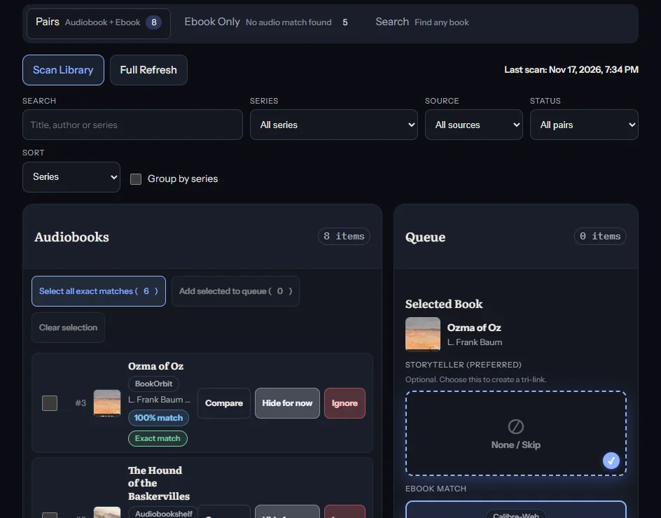
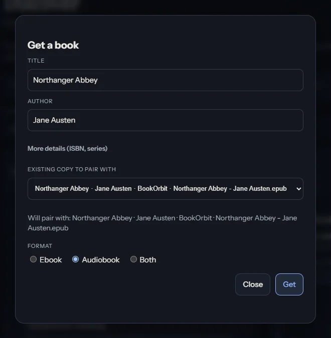

---
hide:
  - toc
description: "What happens from pairing an audiobook with its ebook until every app shows the same position, including requesting a missing audiobook or ebook."
---

# How a new book gets synced

The steps from pairing an audiobook with its ebook to having both in sync.

:material-bookshelf:{ .bb-flow__icon }

**Pair**

An audiobook and its matching ebook.

:material-timer-sand:{ .bb-flow__icon }

**Queue**

Books are processed one at a time, in the order you choose.

:material-waveform:{ .bb-flow__icon }

**Align**

The audio is matched to its position in the text.

:material-book-sync:{ .bb-flow__icon }

**Sync**

Each linked app gets your current position.

:material-tray-arrow-down:{ .bb-flow__icon } **Missing the audiobook or ebook?** BookBridge can request it from BookOrbit or Shelfmark and queues it when it arrives.

## Pair

Discover suggests audiobooks and ebooks that look like the same book. Add the ones you want to the queue, then press **Match All**. You can also search for any book yourself.

{ .bb-shot loading=lazy }

## Request a missing audiobook or ebook

If you have only the ebook or only the audiobook, you can request the other from Discover. BookBridge requests it from BookOrbit or Shelfmark, waits for it to land in your library, makes sure it is the right book and edition, and pairs it with your copy. It then goes into the queue like any other book.

{ .bb-shot loading=lazy width="440" }

## Queue

**Processing** lists every queued book. BookBridge works on one book at a time to limit the load on your server. You can reorder waiting books: move one up, down or to the front. A book with only an ebook or only an audiobook needs no alignment and is ready almost immediately. If a step fails, BookBridge retries it later.

{ .bb-shot loading=lazy width="600" }

## Align

BookBridge compares the audiobook with the ebook's text and records where each word is spoken. The result is a map from any point in the audio to the matching position in the text, and back.

<figure class="bb-align">
  <svg viewBox="0 0 640 150" role="img" aria-label="An audio waveform with its playback position linked to the matching line of ebook text">
    <g>
      <rect class="wave" x="20" y="66" width="5" height="18" rx="2.5"></rect>
      <rect class="wave" x="30" y="58" width="5" height="34" rx="2.5"></rect>
      <rect class="wave" x="40" y="49" width="5" height="52" rx="2.5"></rect>
      <rect class="wave" x="50" y="60" width="5" height="30" rx="2.5"></rect>
      <rect class="wave" x="60" y="43" width="5" height="64" rx="2.5"></rect>
      <rect class="wave" x="70" y="54" width="5" height="42" rx="2.5"></rect>
      <rect class="wave" x="80" y="35" width="5" height="80" rx="2.5"></rect>
      <rect class="wave" x="90" y="47" width="5" height="56" rx="2.5"></rect>
      <rect class="wave" x="100" y="56" width="5" height="38" rx="2.5"></rect>
      <rect class="wave" x="110" y="40" width="5" height="70" rx="2.5"></rect>
      <rect class="wave on" x="120" y="30" width="5" height="90" rx="2.5"></rect>
      <rect class="wave" x="130" y="45" width="5" height="60" rx="2.5"></rect>
      <rect class="wave" x="140" y="53" width="5" height="44" rx="2.5"></rect>
      <rect class="wave" x="150" y="37" width="5" height="76" rx="2.5"></rect>
      <rect class="wave" x="160" y="50" width="5" height="50" rx="2.5"></rect>
      <rect class="wave" x="170" y="61" width="5" height="28" rx="2.5"></rect>
      <rect class="wave" x="180" y="44" width="5" height="62" rx="2.5"></rect>
      <rect class="wave" x="190" y="33" width="5" height="84" rx="2.5"></rect>
      <rect class="wave" x="200" y="52" width="5" height="46" rx="2.5"></rect>
      <rect class="wave" x="210" y="58" width="5" height="34" rx="2.5"></rect>
      <rect class="wave" x="220" y="46" width="5" height="58" rx="2.5"></rect>
      <rect class="wave" x="230" y="55" width="5" height="40" rx="2.5"></rect>
      <rect class="wave" x="240" y="63" width="5" height="24" rx="2.5"></rect>
      <rect class="wave" x="250" y="51" width="5" height="48" rx="2.5"></rect>
    </g>
    <path class="link" d="M 128 75 C 250 75, 300 63, 392 63"></path>
    <circle class="dot" cx="128" cy="75" r="4"></circle>
    <circle class="dot" cx="392" cy="63" r="4"></circle>
    <g>
      <rect class="line" x="404" y="20" width="216" height="8" rx="4"></rect>
      <rect class="line" x="404" y="40" width="196" height="8" rx="4"></rect>
      <rect class="line on" x="404" y="59" width="150" height="8" rx="4"></rect>
      <rect class="line" x="404" y="79" width="210" height="8" rx="4"></rect>
      <rect class="line" x="404" y="99" width="184" height="8" rx="4"></rect>
      <rect class="line" x="404" y="119" width="120" height="8" rx="4"></rect>
    </g>
  </svg>
  <figcaption>A moment in the audiobook, tied to its line in the ebook.</figcaption>
</figure>

- **Forced alignment (default).** BookBridge matches the narration directly against the ebook text. It runs on your server's CPU and needs no GPU or extra services.
- **Transcription (fallback).** For books not in English, narration that differs from the text, or chapters read in a different order, BookBridge transcribes the audio with Whisper and matches the transcript instead.
- **Mismatch check.** If the audiobook and ebook are different books, BookBridge stops and reports it instead of syncing to the wrong position.
- **CPU use.** Alignment uses only the CPU cores available to BookBridge, up to eight, so other services on the server are not starved. Long books can take a while; an interrupted transcription resumes where it stopped.

## Sync

Once the map is ready, the book syncs. After you read on your e-reader, your audiobook app resumes at the same sentence, and the other way round. The book drawer shows your position in each app.

{ .bb-shot loading=lazy }

To set it up, see [Install and first sync](getting-started.md).
