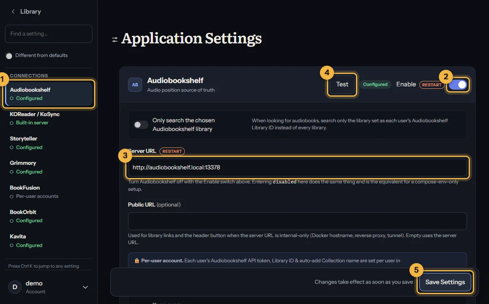
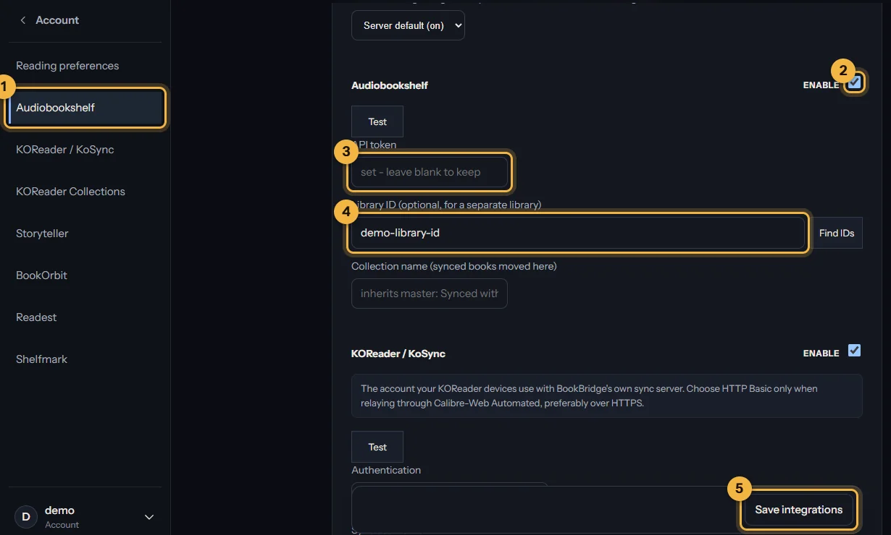
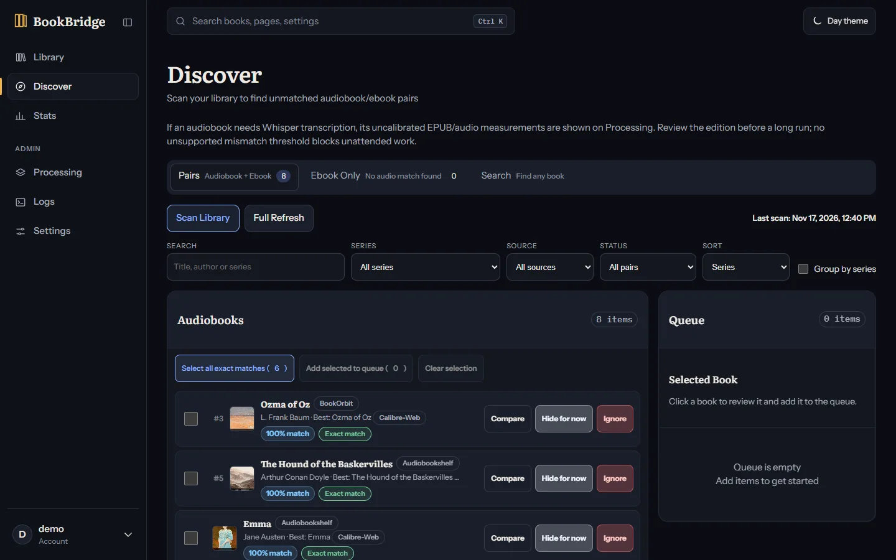

---
hide:
  - toc
description: "Install BookBridge with Docker Compose, connect your apps in the web UI and link your first audiobook and ebook."
---

# Getting Started

Setup takes about ten minutes. You need Docker, and at least two places you read or listen that you want kept on the same page. Everything else happens in the web UI.

## 1. Pick your setup

Every app is optional, and you can add more later. Most people start with one of these:

<div class="bb-pick" markdown>
<div markdown>
Audiobookshelf + KOReader

Listen in Audiobookshelf, read in KOReader on a Kobo, PocketBook, Android or jailbroken Kindle.
</div>
<div markdown>
BookOrbit or Grimmory

One app holds both the audiobook and the ebook. Add KOReader or another reader if you like.
</div>
<div markdown>
Ebook only

No audiobooks: keep two or more readers in step, for example KOReader and Kavita, or a Kobo through Calibre-Web Automated.
</div>
</div>

Step 4 has a tab for each of these. See [Supported apps](supported-apps.md) for everything else BookBridge works with.

## 2. Start BookBridge

Save this as `docker-compose.yml` in a new folder, change the ebook path, and run `docker compose up -d`.

```yaml title="docker-compose.yml"
services:
  bookbridge:
    container_name: bookbridge
    image: ghcr.io/cporcellijr/bookbridge:latest
    restart: unless-stopped
    ports:
      - "8080:5757"
    environment:
      - TZ=America/New_York
    volumes:
      - ./data:/data
      - /path/to/ebooks:/books
```

That is the whole file for most setups. Connections and every other setting are made in the web UI, not here.

??? info "Optional extras for the compose file"
    - **Expose only the sync port to the internet (split-port mode).** Add `- KOSYNC_PORT=5758`
      under `environment` and `- "5758:5758"` under `ports`, then keep `8080` on your LAN or
      behind your reverse proxy. Devices sync through `5758`; the dashboard stays private.
    - **A second ebook library:** mount it, for example `- /path/to/other/library:/calibre_library:ro`,
      and list `/calibre_library` in **Extra Ebook Libraries** under Settings → Server.
    - **Storyteller transcripts:** mount the assets folder, for example
      `- /path/to/storyteller/assets:/storyteller/assets`, and set **Storyteller Assets Path**
      to `/storyteller` under Settings → Server. Storyteller uploads go over its API, so a
      Storyteller library mount is not needed.
    - **GPU transcription:** see [GPU Support](configuration.md#gpu-support-optional).

## 3. Create your account

Open `http://your-server:8080`. The first visit asks you to choose a username and password; that account is the admin. You can add other readers later under **Settings → Users**.

## 4. Connect your apps

Connections live in two places, and each has its own screen:

- **Settings → Services** holds what the whole server shares: which apps are on, and their addresses. Only admins see it.
- **Account → My Integrations** holds your own logins for those apps. Every reader has their own, so everyone keeps their own progress.

{ .bb-shot loading=lazy }

<div class="bb-callouts" markdown>
1. **Pick the app** in the Connections list. Each one shows whether it is configured.
2. **Turn it on** with Enable. Switch off the apps you don't use, Audiobookshelf included.
3. **Enter its address**, the URL you open the app at from the BookBridge server.
4. **Test** checks that BookBridge can reach it.
5. **Save Settings.** A change marked RESTART restarts BookBridge, which takes a few seconds.
</div>

{ .bb-shot loading=lazy }

<div class="bb-callouts" markdown>
1. **Pick the app** in your account's list.
2. **Turn it on for you.**
3. **Your login**: a token, API key or username and password, depending on the app.
4. **Optional fields**, such as an Audiobookshelf library to search.
5. **Save integrations.**
</div>

What to fill in for your setup:

=== "Audiobookshelf + KOReader"

    | Where | What |
    | :--- | :--- |
    | Settings → Services → **Audiobookshelf** | Server URL |
    | My Integrations → **Audiobookshelf** | API token: in Audiobookshelf open **Settings → Users →** your user and generate one |
    | My Integrations → **KOReader / KoSync** | A sync username and password of your choice; you enter the same pair on the device in step 6 |

=== "BookOrbit or Grimmory"

    | Where | What |
    | :--- | :--- |
    | Settings → Services → **Audiobookshelf** | Switch Enable off if you don't use it |
    | Settings → Services → **BookOrbit** or **Grimmory** | Server URL |
    | My Integrations → **BookOrbit** or **Grimmory** | Your username and password. BookOrbit 3.8 and newer can use an API key instead |
    | My Integrations → **KOReader / KoSync** | Only if you also read in KOReader: a sync username and password for the device |

=== "Ebook only"

    | Where | What |
    | :--- | :--- |
    | Settings → Services → **Audiobookshelf** | Switch Enable off |
    | Settings → Services → each reader app | Turn it on and enter its Server URL (KOReader needs none: BookBridge is its sync server) |
    | My Integrations → each reader app | Your login for it, for example a Kavita auth key or a KOReader sync username and password |

Each app's fields are listed in [Configuration](configuration.md), and the [Settings tour](settings-tour.md) shows the rest of Settings.

## 5. Link your first book

Open **Discover**. On **Pairs**, choose **Scan Library**: it lists audiobooks and ebooks that look like the same book. Add the right ones to the queue and choose **Match All**. To link one book by hand, use **Search** instead, pick its audiobook (or **None** for an ebook-only link) and its ebook, and add it to the queue.

{ .bb-shot loading=lazy }

An ebook-only link syncs straight away. An audiobook and ebook pair first gets an alignment map, built in the background: forced alignment takes a few minutes per 10 hours of audio, and the few books it cannot follow are transcribed instead, which takes longer. Watch it on **Processing** (the **Job Queue** in Classic). After that, BookBridge checks your apps every 5 minutes, and sooner when Audiobookshelf or KOReader tell it you moved.

## 6. Connect a KOReader device (optional)

Open **Account → Connect a KOReader device**.

1. **Point KOReader at BookBridge.** Copy the address the card shows into KOReader's **Tools → Progress sync → Custom sync server**, and sign in with the sync username and password from My Integrations. That alone gives you progress sync.
2. **Install the Bridge Sync plugin** for highlights, notes, reading status and stats, and for having books delivered to the device. Download it from the same card, or install **BridgeSync** from a KOReader plugin store such as Storefront.

??? info "Details: the sync address, and installing the plugin by hand"
    The suggested address is built from the one you are browsing BookBridge on, so it already
    carries the right port, including a reverse proxy's HTTPS origin. In split-port mode it
    points at the `KOSYNC_PORT` instead. Enter the base address only, with no `/api` or
    `/koreader` suffix. If you opened BookBridge through `localhost`, replace that with the
    server's LAN name or IP address (or its Tailscale address for a device that leaves home).

    To install the plugin by hand, unzip it into `koreader/plugins/`, restart KOReader, then
    open **Tools → Bridge Sync** and enter the same server address and sync login. Books the
    plugin delivers are byte-for-byte copies of your library files, so their progress links
    without any manual matching. With the plugin, each reader can also turn Grimmory shelves or
    Hardcover lists into KOReader collections.

If KOReader reports **Unknown server error** when you sign in, the address or network path is wrong rather than the password; see [KOReader cannot connect](troubleshooting.md#koreader-cannot-connect-unknown-server-error).

## Next steps

- [Settings tour](settings-tour.md): what each Settings tab is for
- [User Guide](user-guide.md): the Library, Discover, highlights and notes
- [Supported apps](supported-apps.md): what BookBridge syncs with each app
- [Troubleshooting](troubleshooting.md): logs and common fixes
