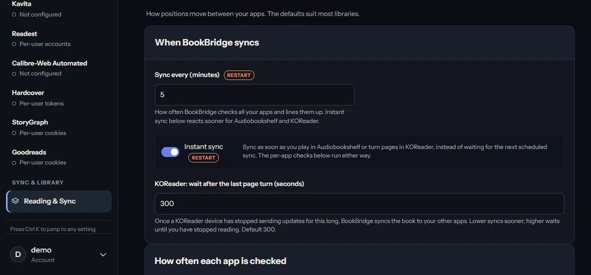
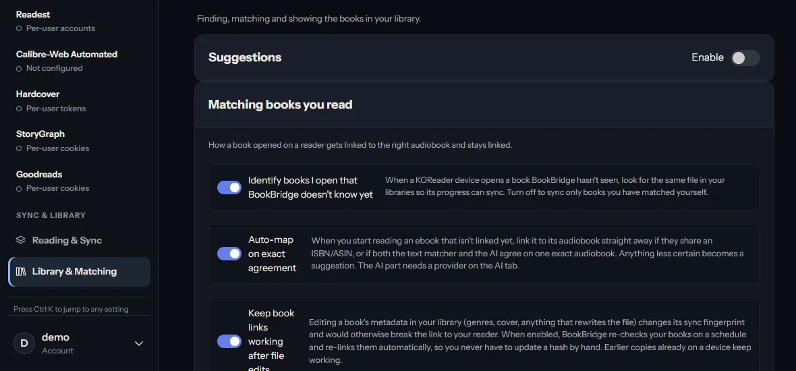
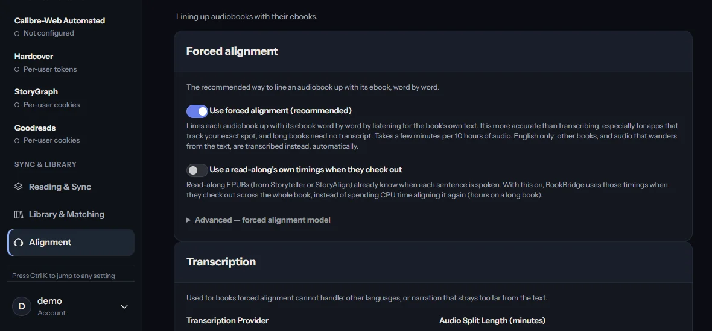
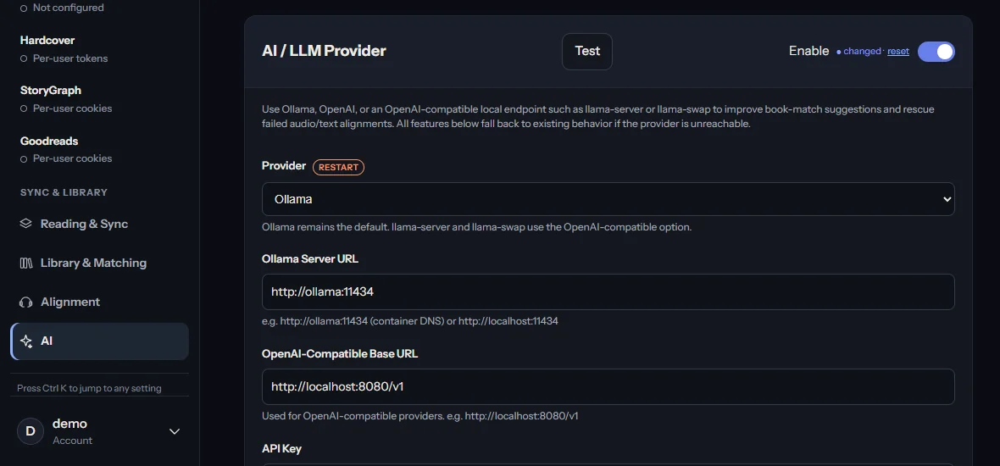
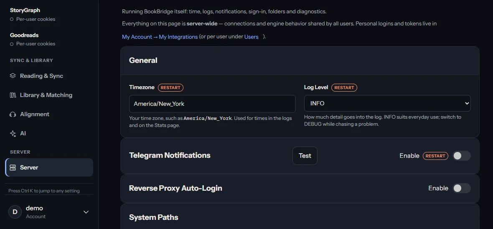
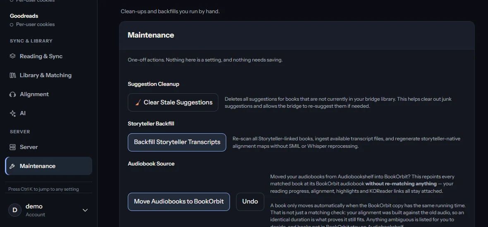

---
hide:
  - toc
description: "A tour of BookBridge's Settings page: what each tab is for and the settings people actually change."
---

# Settings tour

**Settings** holds what the whole server shares and is only visible to admins. Each reader's own logins and preferences are under **Account → My Integrations**. The defaults suit most libraries, so you can leave most of this alone.

A few things work the same on every tab:

- **Find a setting** at the top of the sidebar (or **Ctrl K**) jumps to any setting by name.
- **Different from defaults** lists every setting you have changed, each with a **reset** link.
- **RESTART** marks a setting that BookBridge reads at startup. Saving a change to it restarts BookBridge, which takes a few seconds. Everything else applies as soon as you save.
- **DEFAULT FOR READERS** marks a setting each reader can override for themselves under My Integrations → Reading preferences.

The app connections at the top of the sidebar are covered in [Getting Started](getting-started.md#4-connect-your-apps) and [Configuration](configuration.md). The tabs below them:

## Reading & Sync

How positions move between your apps.

{ .bb-shot loading=lazy }

- **When BookBridge syncs:** the full check every 5 minutes, instant sync for Audiobookshelf and KOReader, and how long to wait after the last KOReader page turn.
- **How often each app is checked:** give apps that can't notify BookBridge their own, faster timer.
- **Posting to trackers:** when Hardcover, StoryGraph and Goodreads get your progress.
- **Highlights & notes, Finished books, Protecting your place:** copying highlights between devices, marking a finished book finished everywhere, and the guards that stop an out-of-date device pulling you backwards.
- **Reading sessions, Reading history & stats:** how sessions are counted and shared.

## Library & Matching

Finding, matching and showing the books in your library.

{ .bb-shot loading=lazy }

- **Suggestions:** turns on Discover's Pairs and Ebook Only scans, with optional scheduled scans.
- **Matching books you read:** link a book you open on a reader automatically, and keep links working after a library app rewrites the file.
- **"Up Next" shelf, Shared Library, Series Display:** a watched shelf that links whatever you put on it; showing every matched book to every reader (each keeps their own progress); and how series show in the Library.
- **Getting books, Shelfmark:** requesting a missing audiobook or ebook; see [Getting missing books](user-guide.md#getting-missing-books).

## Alignment

Lining audiobooks up with their ebooks.

{ .bb-shot loading=lazy }

- **Forced alignment** is on by default and handles most books in a few minutes per 10 hours of audio.
- **Transcription** (local Whisper or a remote service) is the fallback for other languages and narration that strays from the text. A GPU makes it much faster; see [GPU Support](configuration.md#gpu-support-optional).
- **Safety checks** catch an audiobook paired with the wrong ebook.
- **Alignment Health** scores each book's map and lets you rebuild or restore one.

## AI

An optional local or hosted language model, off by default.

{ .bb-shot loading=lazy }

Point it at Ollama, OpenAI or any OpenAI-compatible server (llama-server, llama-swap) for smarter match suggestions and for rescuing alignments that fail. Everything falls back to normal behaviour when the model is unreachable.

## Server

Running BookBridge itself.

{ .bb-shot loading=lazy }

- **General:** time zone and how much goes into the log. Switch the log level to DEBUG only while chasing a problem.
- **Telegram Notifications:** errors sent to a Telegram chat.
- **Reverse Proxy Auto-Login:** lets a sign-in page in front of BookBridge, such as Authelia or Authentik, sign people in.
- **System Paths:** data and library folders, extra ebook libraries and Storyteller folders.
- **Background jobs, Diagnostics:** how often a failed job, such as aligning a book, is retried; optional anonymous diagnostics and the **Send bug report** form.

## Maintenance

One-off actions you run by hand. Nothing here is a setting, and nothing needs saving.

{ .bb-shot loading=lazy }

Clear stale Discover suggestions, re-import Storyteller transcripts, move matched audiobooks from Audiobookshelf to BookOrbit without losing progress, fill in series details, and review cached files that may no longer be needed.

## Users and Logs

**Users** adds and removes reader accounts, sets who is an admin, and lets an admin fill in a reader's integrations for them. **Logs** is the live log viewer, the first place to look when something doesn't sync; see [Troubleshooting](troubleshooting.md).
