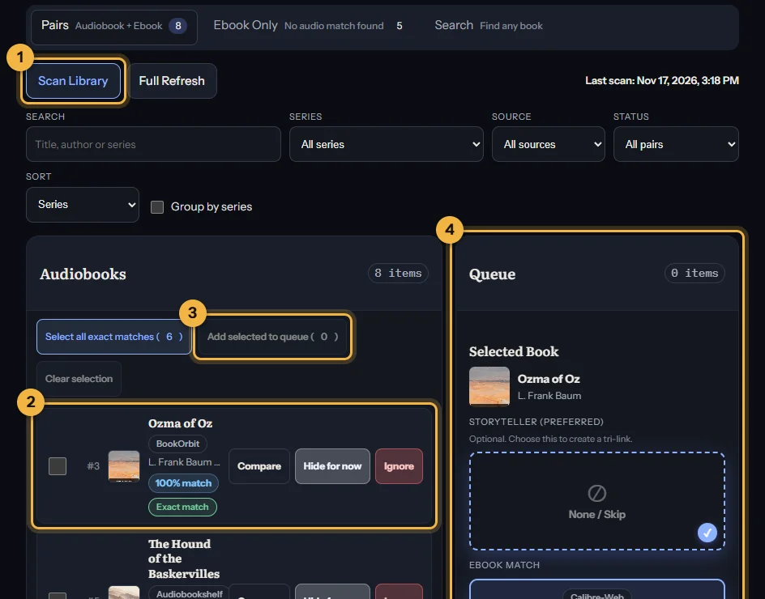
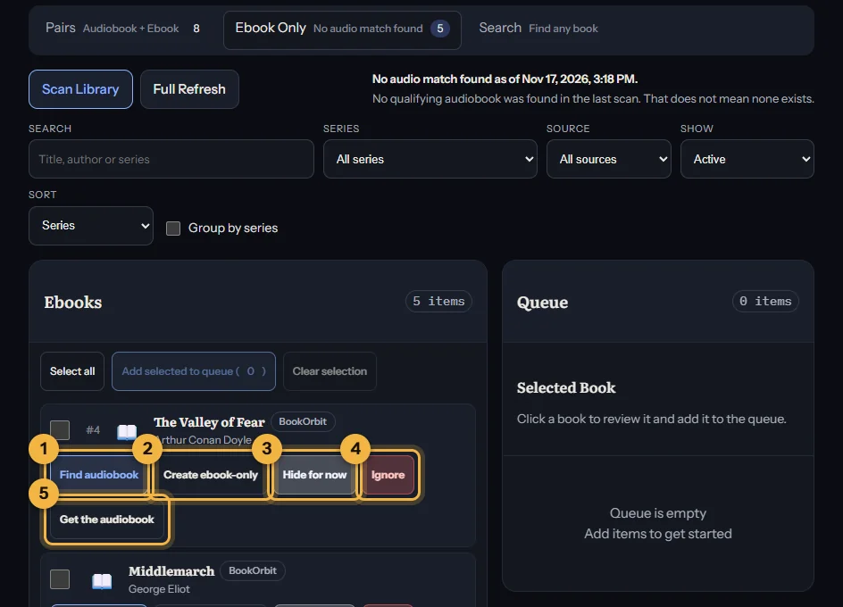
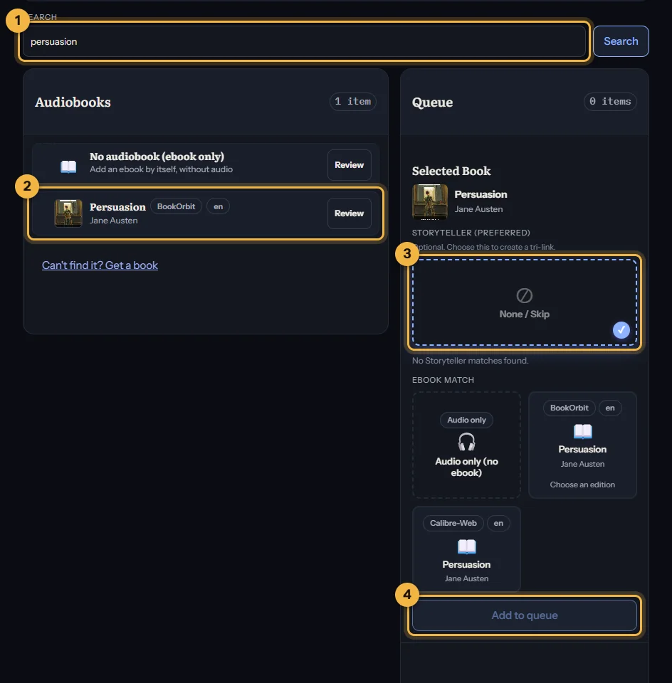

# Discover

Discover is where you link books that BookBridge does not sync yet. Every reader has their own scans, picks and queue. It has three tabs:

| Tab | Use it when |
| :--- | :--- |
| [**Pairs**](#pairs) | BookBridge found an audiobook and an ebook that look like the same book. |
| [**Ebook Only**](#ebook-only) | You have an ebook and the last scan found no audiobook for it. |
| [**Search**](#search) | You want a particular book, or to choose every part of the link yourself. |

Whichever tab you use, picks go into one **queue** on the right, and nothing is linked until you press **Match All**. When a book is missing its audiobook or its ebook, see [Get a missing book](get-books.md).

## Pairs

{ .bb-shot loading=lazy }

1. **Scan Library** looks for new pairs, reusing earlier results to stay quick. **Full Refresh** rescans everything.
2. **A suggested pair**, with where the audiobook came from and how well it matches. **Compare** shows the other ebook candidates; **Hide for now** hides it for this browser session; **Ignore** hides it for good, and you can undo it.
3. Tick pairs, or **Select all exact matches**, then **Add selected to queue**.
4. **The queue.** Clicking a pair shows it here, so you can check the ebook and optionally choose a Storyteller title before adding it.

Books group by series; untick **Group by series** for a flat list. Each tab remembers its own filters.

## Ebook Only

{ .bb-shot loading=lazy }

1. **Find audiobook** opens Search with this ebook already chosen.
2. **Create ebook-only** syncs the ebook on its own, without audio.
3. **Hide for now** hides it in this browser session only. Nothing is saved.
4. **Ignore** hides it for good. Change **Show** to find it again.
5. **Get the audiobook** asks for the missing audiobook. See [Get a missing book](get-books.md).

"No audio match" only means none turned up in the last scan, not that none exists.

## Search

{ .bb-shot loading=lazy }

1. **Search** your libraries by title, author or file name.
2. **Pick the audiobook.** Choose **No audiobook (ebook only)** to link an ebook by itself.
3. **Storyteller title** (optional), for read-along. Leave it on **None / Skip** if you do not use Storyteller.
4. **Pick the ebook** under **Ebook match**, then **Add to queue**. Choose **Audio only (no ebook)** to sync just the audiobook.

## Finish in the queue

**Match All** links everything in the queue. With a Storyteller account, **Create Storyteller Edition & Match All** has Storyteller build a read-along edition first. When the queue holds a BookOrbit audiobook, you can tick **Also generate read-along EPUBs** to get a [read-along EPUB](../user-guide.md#read-along-epubs-for-bookorbit) too.

New links then show in [Processing](processing.md) while BookBridge lines up the audiobook with the text. An ebook-only or audio-only link starts syncing straight away.

??? info "Other options"
    - **Scheduled scans** (admin): **Settings → Library & Matching → Scheduled Scan Interval** scans in the
      background, and **Scheduled Full Refresh** runs a full rescan on a schedule.
    - **Ignore local files in Suggestions** (admin) leaves files from your local folders out of Pairs and Ebook Only.
    - A book with more than one ebook file in BookOrbit or Grimmory asks which edition you mean, and BookBridge
      keeps using that file. See [Choosing an ebook edition](../provider-ebook-file-selection.md).
    - CBZ comics can be linked as ebook-only.
    - Books can also be added without Discover. See [Automatic ways books get added](../user-guide.md#automatic-ways-books-get-added).
