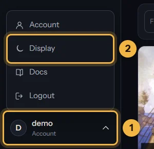
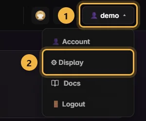

---
hide:
  - toc
description: "Display: choose Classic or New, the theme, the library style and what book covers show, with a live preview."
---

# Display

Display holds every look-and-feel choice for your account, including switching between Classic and New. Changes save as you make them and follow you to every device you sign in on.

## 1. Open Display

=== "New"

    { .bb-shot loading=lazy }

    1. Click your name at the bottom of the sidebar. On phones, open the account avatar at the top right.
    2. Choose **Display**.

=== "Classic"

    { .bb-shot loading=lazy }

    1. Click your name at the top right.
    2. Choose **Display**.

    Classic opens the **Display** card on Account. Choose **New** under **Interface** to use the controls shown below.
    Classic's series preference uses **Save display**.

## 2. Choose how it looks

{ .bb-shot loading=lazy }

1. **Live preview,** built from your own library.
2. **Look:** Classic or New. See [Classic and New](../new-interface.md).
3. **Theme:** Follow device (the default), Day or Night. The Day/Night button in the sidebar changes the same setting. **Accent colour** (Amber, Teal, Rose, Violet or Blue) colours progress bars, highlights and the current-page marker.
4. **Library style:** Cards, Face-out shelves, Spine shelves or List. The two shelf styles also take a shelf finish: Match theme, Wood, Walnut, Cherry, White, Dark, Plain, Glass or Pastel, and **Shelf props**: a plant, a candle or a small stack of books every few books, with bookends on Spine shelves. Face-out shelves also take a **Cover finish**: Standard, Hardcover, Paperback or Flat. **Group series** in the Library filters keeps each series together, in reading order, on the shelf styles and in List too. **Library background** can show a soft blur of the book you are reading behind your Library.
5. **Book covers:** cover size, and whether covers show progress, the finished tick, the format strip, rating stars, and the title and author.

Further down:

| Section | What you can choose |
| :--- | :--- |
| **Book covers** | **Current book on series stacks** shows the book you are on as the series' cover. |
| **Layout** | What the reading-now card on the Library shows on wider screens: synopsis, book stats and reading streak. Phones keep the simple card, and anything without data is left out. |
| **Behaviour** | Whether the reading-now card appears at all. |

The library style, cover and card choices shape the New interface's Library.
