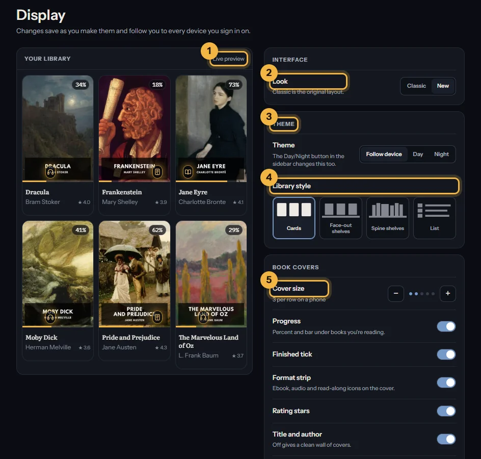

---
hide:
  - toc
description: "Display: choose Classic or New, the theme, the library style and what book covers show, with a live preview."
---

# Display

**Account → Display** holds every look-and-feel choice for your account. Changes save as you make them and follow you to every device you sign in on.

{ .bb-shot loading=lazy }

1. **Live preview,** built from your own library.
2. **Look:** Classic or New. See [Classic and New](../new-interface.md).
3. **Theme:** Follow device (the default), Day or Night. The Day/Night button in the sidebar changes the same setting.
4. **Library style:** Cards, Face-out shelves, Spine shelves or List. The two shelf styles also take a shelf finish.
5. **Book covers:** cover size, and whether covers show progress, the finished tick, the format strip, rating stars, and the title and author.

Further down:

| Section | What you can choose |
| :--- | :--- |
| **Book covers** | **Current book on series stacks** shows the book you are on as the series' cover. |
| **Layout** | What the reading-now card on the Library shows on wider screens: synopsis, book stats and reading streak. Phones keep the simple card, and anything without data is left out. |
| **Behaviour** | Whether the reading-now card appears at all. |

Classic readers open the same page from the user menu. The library style, cover and card choices shape the New interface's Library.
