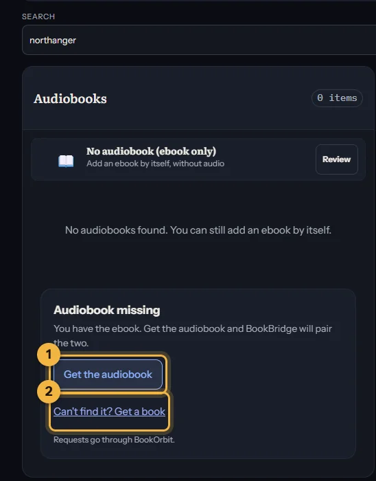
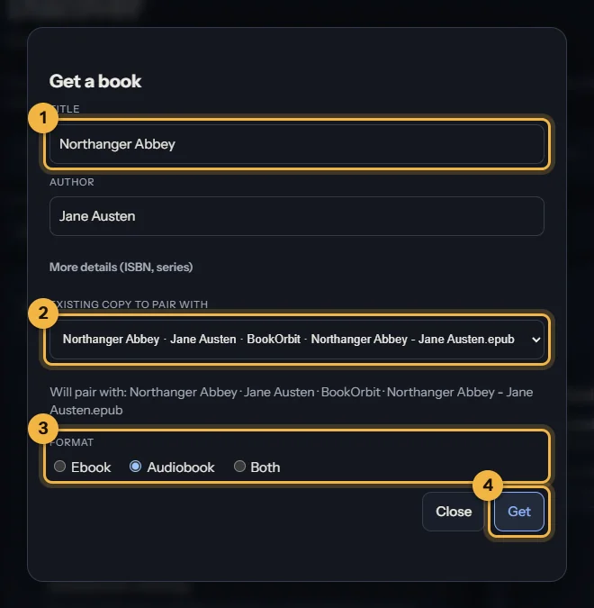

---
hide:
  - toc
description: "Ask BookOrbit or Shelfmark for a missing audiobook or ebook, and let BookBridge pair it with your copy when it arrives."
---

# Get a missing book

When you have the ebook but not the audiobook (or the other way round), BookBridge can ask for the missing half and pair it with your copy when it arrives. Requests go through **BookOrbit** or **Shelfmark**, using your own login on each. It works the same in Classic and New.

## 1. Find the book

Search for it on Discover's **Search** tab. When only one half is in your libraries, a box says what is missing.

{ .bb-shot loading=lazy }

1. **Get the audiobook** (or **Get the ebook**) asks for the missing half of this book. Ebook Only rows have the same button.
2. **Can't find it? Get a book** asks for a book that is not in your libraries at all.

## 2. Ask for it

{ .bb-shot loading=lazy }

1. **Title** and **Author**, filled in for you. **More details** takes an ISBN or series.
2. **Existing copy to pair with:** the copy you already have. Choose **Do not pair with a current copy** to just get the book.
3. **Format:** Ebook, Audiobook or Both.
4. **Get** sends the request. With Shelfmark you first choose a release from its results.

## 3. Follow it

Your requests show as **My requests** on Discover and under **Book requests** in [Processing](processing.md), from request to download, import and pairing. A request ends as **Paired**, **Declined**, **Cancelled** or **Failed**. If BookBridge cannot be sure the new file is the book you asked for, it marks it **Needs a look** and sends it to Discover for you to check instead of guessing.

A download with no progress for 30 minutes says so. Nothing is cancelled for you.

??? info "Setup and options"
    - **Who can use it:** admins always can. Other readers need **Let readers get missing books** turned on in
      **Settings → Library & Matching** (off by default).
    - **BookOrbit:** uses your BookOrbit login from **Account → My Integrations**. When BookOrbit does not grab
      releases by itself, you can **Pick a release** in BookBridge; that needs the BookOrbit permission
      "Download books directly" on the login BookBridge uses.
    - **Shelfmark:** add your Shelfmark login under **Account → My Integrations**. Set **Audiobook destination
      library** there so BookBridge asks BookOrbit to scan a new audiobook in.
    - **Follow audiobook requests I make in BookOrbit** also pairs audiobooks you requested inside BookOrbit in the
      last 30 days with your ebook when the title, authors and series match.
    - New books are found in your BookOrbit library only.
    - See [Shelfmark](../apps/shelfmark.md) and [BookOrbit](../apps/bookorbit.md) for setup.
