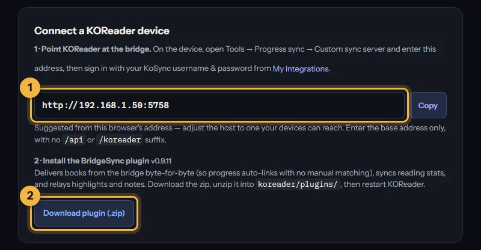
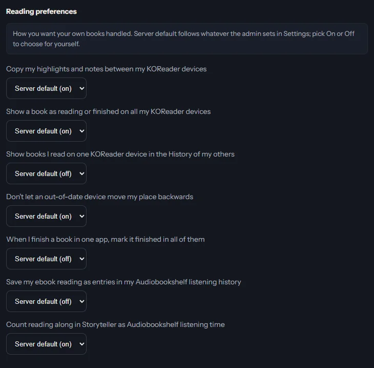

# KOReader devices

Plain KOReader syncs your reading position with BookBridge. The free **Bridge Sync** plugin adds the rest: highlights and notes, reading status and History across your devices, collections, and delivering books to the device. To set up the sync server first, see [KOReader](../apps/koreader.md).

## Connect a device

**Account → Connect a KOReader device**

{ .bb-shot loading=lazy }

1. **The address KOReader syncs to.** It is filled in from your browser's address; change the host to one your devices can reach, and **Copy** it into KOReader under **Tools → Progress sync → Custom sync server**.
2. **Download plugin (.zip)**, unzip it into `koreader/plugins/` on each device, and restart KOReader.

Use the current plugin on every device. After upgrading from an older plugin, close the books you were reading and run **Bridge Sync → Sync Reading Stats** once; your positions and highlights are kept.

## Choose what your devices share

**Account → My Integrations → Reading preferences**

{ .bb-shot loading=lazy }

Each line starts on **Server default**, which follows what the admin set in Settings. Pick **On** or **Off** to decide for yourself.

| Preference | What it does |
| :--- | :--- |
| **Copy my highlights and notes between my KOReader devices** | Highlights, notes, edits and deletions reach your other devices and supported web readers. |
| **Show a book as reading or finished on all my KOReader devices** | A book you start on one device shows as in progress on the others, even one that was delivered but never opened there. A book BookBridge sees finished in any app shows as finished. A status you set on a device yourself is kept. |
| **Show books I read on one KOReader device in the History of my others** | Adds books you read elsewhere to each device's History, so shelves built from History fill in. Only books already on that device, read in the last 30 days, at most 25 per sync. |
| **Don't let an out-of-date device move my place backwards** | A device that is behind your current place cannot pull you back to it. |
| **When I finish a book in one app, mark it finished in all of them** | Finishing anywhere marks the book finished in every app it syncs with. |

The last two lines are about Audiobookshelf and Storyteller listening time.

## Highlights and notes

With the plugin installed and the highlights preference on, highlights and notes you make in KOReader sync on their own. In the plugin menu, **Sync Highlights** exchanges them now, and **Sweep All Highlights** sends highlights that were on the device before you installed the plugin.

Web readers join in when the reader has them set up in **My Integrations**: Grimmory (turn on **Highlight Sync**), BookOrbit (your BookOrbit KOReader sync login), BookFusion (**Highlight Sync**), and Readest or Hardcover.

## Collections and delivery

- **Sync books** in the plugin downloads your matched books to the device. They arrive identical to the library copy, so they link to BookBridge by themselves.
- **KOReader Collections** (My Integrations) turns your Grimmory shelves or Hardcover lists into KOReader collections. See [KOReader collections](../apps/koreader.md#koreader-collections-optional).
- **Only download books on these Grimmory shelves** (My Integrations) limits which books **Sync books** puts on the device. Leave it blank for all of them.

??? info "When two devices disagree about your position"
    Normally the position furthest along wins. **When two KOReader devices disagree** (**Settings → Services →
    KOReader / KoSync → Advanced — cross-device progress**) can let the device you are actually reading on win
    instead, once it has shown several forward page turns in a row. It starts on **Watch and log only**, which
    logs what it would do without changing anything, so you can check it against your own devices before
    switching it on.

??? info "A book on the device says hash not found"
    The file on the device is not identical to the library copy, for example after a Kindle transfer or a
    download that changed the file's details. Deliver it with **Sync books** instead, or link it by hand under
    **Reader Documents** on Discover's **Search** tab.
