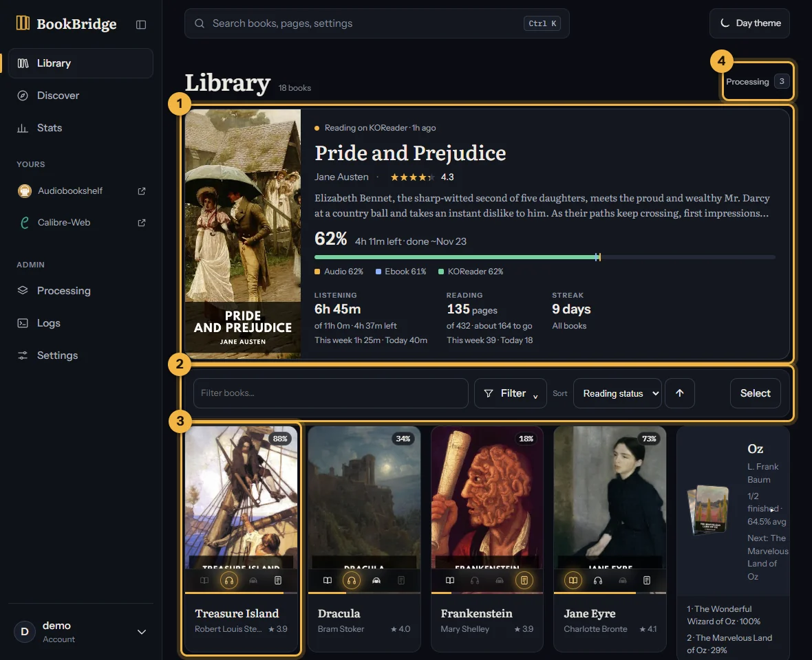
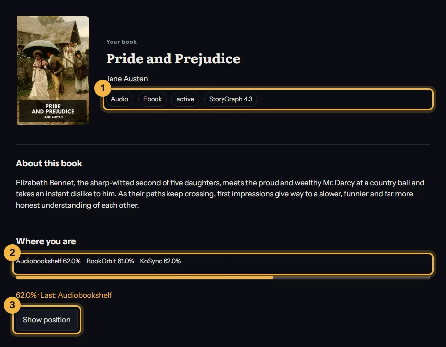
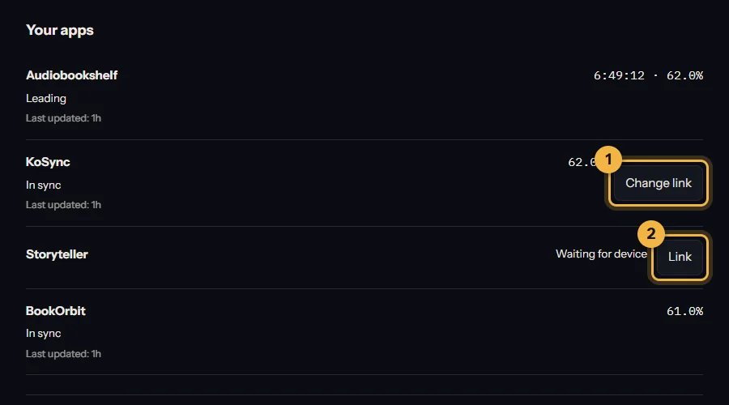
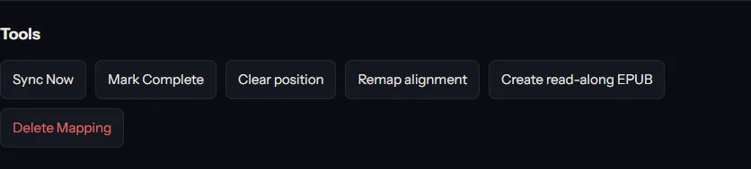

---
hide:
  - toc
description: "The Library: the book you are reading now, filters and sorting, and the book drawer with your position in every app."
---

# Library

The Library shows every book you sync, starting with the one you are reading now. In Classic it is called the **Dashboard**.

{ .bb-shot loading=lazy }

1. **Reading now:** the book that synced most recently. One bar marks where each app is, with time or pages left and a likely finish date. Choose what it shows on the [Display](display.md) page.
2. **Filter, sort and select:** filter by author, series or format, sort by reading status, title, author, series, progress, last synced, date added or rating, and **Select** several books at once. Typing a book you have not matched yet offers to look for it in Discover.
3. **A book:** progress, a tick once finished, and a strip showing where it is linked (ebook, audiobook, read-along, KOReader). Click it to open the book drawer.
4. **Processing:** how many books are being matched or aligned. Opens [Processing](processing.md).

Series stack into one card. Click the strip along the bottom to open the rest of the series.

## The book drawer

Opening a book shows everything about it in one place. In Classic, the same actions are on the book card.

{ .bb-shot loading=lazy }

1. **What you have:** audiobook, ebook, its state and its rating.
2. **Where you are** in every app, on one bar.
3. **Show position:** a short excerpt of the text with a marker where you are synced to. A percentage-only position is labelled approximate.

{ .bb-shot loading=lazy }

**Your apps** lists each app's position. **Leading** is the app the last sync followed; **Waiting for device** means the app has not reported this book yet.

1. **Change link:** point this book at a different file in that app.
2. **Link:** connect this book to an app it is not linked to yet, such as a Storyteller title.

{ .bb-shot loading=lazy }

| Tool | What it does |
| :--- | :--- |
| **Sync Now** | Syncs this book straight away instead of waiting for the next cycle. |
| **Mark Complete** | Sets progress to 100% in every app this book syncs with, then asks whether to remove it from BookBridge too. |
| **Clear position** | Clears this book's progress, for a re-read. |
| **Remap alignment** | Rebuilds the audiobook-to-ebook map and keeps your position. Admins can compare and restore maps under **Settings → Alignment → Alignment Health**. |
| **Create read-along EPUB** | Builds an EPUB with highlighted narration for BookOrbit. See [Read-along EPUBs](../user-guide.md#read-along-epubs-for-bookorbit). |
| **Delete Mapping** | Stops syncing the book. Your files stay where they are. |

??? info "Going back on purpose"
    **Honor a Deliberate Rewind** (on by default, **Settings → Reading & Sync**) lets you go back in a book.
    After you go back, keep reading or listening from the new spot, so BookBridge can tell your rewind
    from an old device reporting late.
