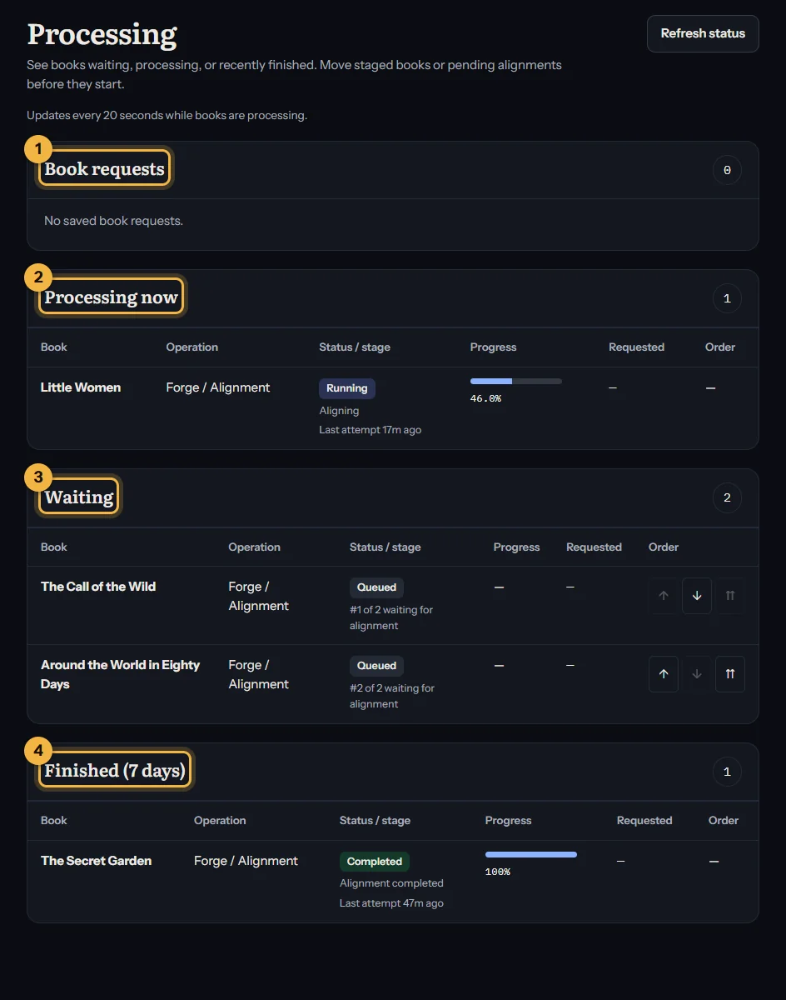

---
hide:
  - toc
description: "Processing: book requests, books being matched or aligned, the waiting order, and recently finished work."
---

# Processing

Processing shows the work BookBridge is doing on your books: lining up a new audiobook with its ebook, building read-along EPUBs, and your book requests. In Classic it is called the **Job Queue**. The page updates itself every 20 seconds while books are processing.

{ .bb-shot loading=lazy }

1. **Book requests:** books you asked for with [Get a missing book](get-books.md), from request to download, import and pairing.
2. **Processing now:** the book being worked on, with its stage and progress.
3. **Waiting:** books in line, with their place (for example *#1 of 2*). The arrows move a book up, down or to the top. You can move only your own books, and not one that has already started. The order is kept across restarts.
4. **Finished (7 days):** work that finished in the last week.

??? info "Before a long transcription"
    When a book needs a full transcription, Processing first shows how its ebook's word count compares with the
    audiobook's length and, once you have five measured books, with the rest of your library (for example
    "2.01× your library median"). A number far from 1× usually means the wrong pairing, such as an omnibus
    ebook with a single narrated volume. It is a measurement only: work carries on, **Dismiss** hides the note,
    and the final content check still refuses a real mismatch.
