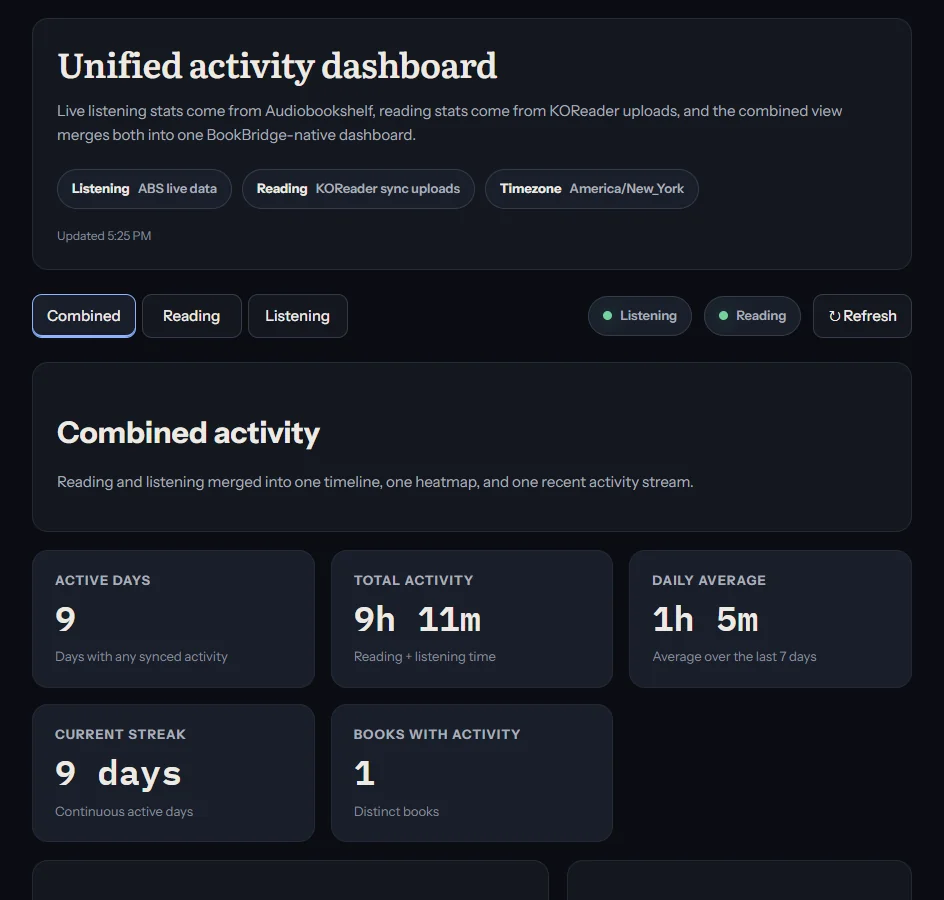

---
hide:
  - toc
description: "Stats: your own reading and listening time, streaks, heatmap and yearly recap."
---

# Stats

Every reader can open **Stats** for their own reading and listening. It has the same name in Classic.

{ .bb-shot loading=lazy }

- **Combined**, **Reading** and **Listening** switch between both together and each on its own: daily totals, streaks, a 12-month heatmap, recent sessions and a yearly recap.
- **Reading** comes from the reading stats KOReader sends to BookBridge.
- **Listening** comes from your own Audiobookshelf account when it is set up. Otherwise BookBridge uses the listening it recorded itself, including BookOrbit and Grimmory audiobooks.
- The recap counts each book you finished that year once, even if you finished it as both ebook and audiobook. Step it back a year to see that year on the heatmap.

??? info "How listening time is counted"
    Listening time BookBridge records itself is an estimate from changes in audio position, and covers only
    sessions it saw, not a service's whole history. Removing a book from BookBridge keeps its sessions, so your
    totals stay.
